# InsightFlow AI

**An AI-powered universal data analytics, visualization and decision support platform**

*Final-year project: "Modern Data Warehouse–Driven Decision Support and Analytics Framework" (built as a self-hosted alternative to Power BI, with custom dashboards).*

InsightFlow AI lets users upload or connect data in many formats (CSV, Excel, JSON, Parquet, SQL databases, REST APIs). It then runs automated **ETL** into a central **data warehouse**, works out the structure of the data and how datasets relate to each other, and **generates interactive dashboards, KPIs, trend analysis, forecasts, anomaly detection, key-driver analysis and plain-language recommendations**. Users don't need any technical or analytical background to get these results.

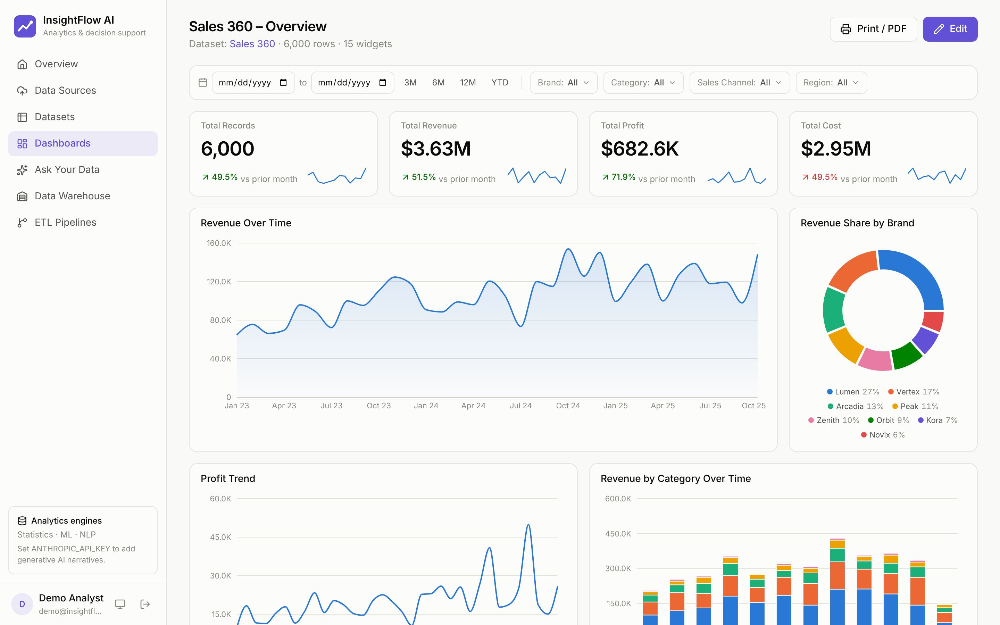

---

## Contents
- [Features](#features)
- [Tech stack](#tech-stack)
- [Architecture](#architecture)
- [Quick start](#quick-start)
- [Demo walkthrough](#demo-walkthrough)
- [Project structure](#project-structure)
- [REST API](#rest-api)
- [Testing](#testing)
- [Configuration](#configuration)
- [Screenshots](#screenshots)
- Documentation: [Architecture & design](docs/ARCHITECTURE.md) · [Project report](docs/PROJECT_REPORT.md)

---

## Features

| Area | What it does |
|---|---|
| **Multi-source ingestion** | Upload CSV/TSV/Excel (each sheet becomes a dataset)/JSON/Parquet, **one file or up to 20 at once**. In a batch upload, related files are linked by their shared keys and joined into an integrated dataset automatically. Connect to any SQLAlchemy database (PostgreSQL, MySQL, SQL Server, SQLite…) by table or custom query. Pull from REST APIs that return JSON or CSV, with an optional auth header and records path. |
| **Automated ETL** | A 12-step, fully logged pipeline: column-name standardisation, whitespace/null-token cleanup, type inference (currency like `$1,234.50`, `(50)` negatives, percentages, mixed date formats, yes/no booleans), de-duplication, unifying inconsistent labels (`north`, `NORTH `, `North` → `North`), dropping sparse columns, outlier flagging/capping, and imputing missing values. Each rule can be switched on or off. |
| **Data warehouse** | DuckDB columnar warehouse with **staging** (`stg_`), **core** (`dw_`), **mart** views (`mart_*_monthly`, `mart_*_by_<dim>`) and a shared conformed **date dimension** (`dim_date`). |
| **Scheduled refresh** | A background scheduler re-runs ETL for each source on its interval (hourly, daily and so on). Every run is recorded with its step log, row counts and duration. |
| **Schema understanding** | Infers semantic types (currency, percentage, count, datetime, geo, email, identifier, categorical, text) and analytical roles (measure / dimension / time / identifier), plus default aggregations. |
| **Relationship discovery** | Finds primary-key/foreign-key links *across datasets* by comparing value containment and name similarity. Shows them as an ER diagram and lets you join them into an integrated dataset with one click. |
| **Data quality scoring** | Scores completeness, uniqueness, validity and consistency (0–100) before and after cleaning, with a count of issues fixed. |
| **Auto dashboards** | KPI cards (with month-over-month change and a sparkline), area/line trends, donut, stacked bars, bar/horizontal bar charts, histogram, scatter, correlation heatmap and top-N table. Chart types are chosen from the schema. |
| **Custom dashboards** | Chart builder with a live preview (12 chart types, any measure/aggregation/grouping/series/time grain). Widgets can be moved, resized and edited. Global filters (date range with presets, multi-select dimensions) apply to every widget. Each chart can be shown as a table or as SQL, and dashboards can be printed or saved as PDF. |
| **Statistics** | Descriptive stats, distributions, skew, and Pearson/Spearman correlation matrices with p-values. |
| **Trends & forecasting** | Picks the time grain automatically, fits a linear trend with a significance test, detects seasonality, and forecasts with **Holt-Winters** (grid-searched parameters, 95% prediction band, backtest MAPE). Also flags anomalous periods using a robust z-score. |
| **Anomaly detection** | **Relationship-aware Isolation Forest**: adds log-ratio features for correlated measures so records that break a normal relationship (for example cost > revenue) are caught too, with per-record explanations ("cost is unusually high, 7.6σ"). |
| **Key-driver analysis** | A **Random Forest** model ranks which factors explain a target metric. It excludes "component" measures (such as cost inside revenue) so they aren't reported as drivers. |
| **Segmentation** | **K-Means** clustering with k chosen automatically by silhouette score, a PCA projection and a profile of each segment. |
| **Combined dashboards** | One dashboard over several files: integrated cross-file charts first, then a labelled section per file. Shared filters apply to every chart that has the column (the date range uses each file's own date column), and the chart builder lets you pick the dataset for each chart. Created automatically by a batch upload, or on demand from the Insights Hub. |
| **Insights Hub** | Combined insights across several datasets (for example everything from one batch upload). Findings from every dataset are ranked together, duplicates are merged, and you get a cross-dataset action plan, the links between datasets, and an optional Sarvam AI briefing across all of them. |
| **Insights & recommendations** | A rule engine turns the findings into ranked, plain-language insights, each with a recommended action. It knows whether higher is better for a metric (rising cost is flagged as a risk, not a success). Also produces an executive summary and action plan, and an HTML report you can download. |
| **Ask your data (NLQ)** | Ask questions in plain English, such as "revenue by region per quarter", "top 5 brands", or "how many orders in 2024 in North?". A built-in semantic parser understands aggregations, groupings, time grains, filters, top-N and synonyms. Answers come as a chart, a table and the generated SQL, and can be pinned to a dashboard. |
| **Optional generative AI** | With `SARVAM_API_KEY` set, Sarvam AI writes executive briefings from the computed findings and turns free-form questions into validated, read-only SQL. **Everything works without it.** |
| **SQL console** | Read-only SQL over your own warehouse tables, with a statement guard and file-system access disabled. |
| **Platform** | JWT authentication, per-user data isolation, light/dark/system theme, responsive layout, CSV/Excel/JSON export. |

## Tech stack

| Layer | Technology | Why |
|---|---|---|
| Frontend | **React 19 + TypeScript + Vite**, Tailwind CSS, **Recharts**, React Router, Lucide icons | A fast, typed component UI. Recharts covers the interactive chart types and the heatmap and diagrams are custom. |
| API | **FastAPI** (Python 3.11+) | Async, typed, generates OpenAPI docs automatically (`/docs`), and works well with Python's data ecosystem. |
| Data warehouse | **DuckDB** | An embedded columnar OLAP engine: fast analytical SQL with no separate server to run. |
| Metadata store | **SQLAlchemy + SQLite** (swappable for PostgreSQL via `INSIGHTFLOW_METADATA_URL`) | Holds users, the dataset catalog, ETL runs and dashboards. |
| ETL / analytics | **pandas, NumPy, SciPy** | Extraction, cleaning and statistics. |
| Machine learning | **scikit-learn** (Isolation Forest, Random Forest, K-Means), custom Holt-Winters | Anomalies, drivers, segmentation and forecasting. |
| Connectors | SQLAlchemy (any SQL database), `requests` (REST), openpyxl/pyarrow (Excel/Parquet) | Covers the common source types. |
| Generative AI (optional) | **Sarvam AI** (`sarvam-105b`, an Indian sovereign LLM) via the official `sarvamai` SDK | Narratives and text-to-SQL. Only aggregated findings and schema are sent, never raw rows. |
| Deployment | Docker (multi-stage), docker-compose | A single container serves both the API and the UI. |

## Architecture

```mermaid
flowchart LR
  subgraph Sources
    F[CSV / Excel / JSON / Parquet]
    D[(SQL databases)]
    A[REST APIs]
  end
  subgraph ETL["ETL pipeline (logged, scheduled)"]
    E[Extract] --> T[Transform<br/>clean · type · dedupe · impute] --> P[Profile<br/>semantic types · quality] --> L[Load]
  end
  subgraph DW["DuckDB data warehouse"]
    S[stg_* staging] --> C[dw_* core] --> M[mart_* views]
    DD[dim_date]
  end
  subgraph Engine["Analytics engine"]
    ST[Statistics & correlations]
    TR[Trends · seasonality · Holt-Winters]
    ML[Isolation Forest · Random Forest · K-Means]
    IN[Insight & recommendation rules]
    NL[NL-to-query parser]
    LLM[Sarvam AI LLM (optional)]
  end
  UI[React UI<br/>dashboards · insights · ask · warehouse]
  F & D & A --> E
  L --> S
  C --> Engine
  M --> UI
  Engine -->|FastAPI REST| UI
```

The full design (warehouse layers, ETL steps, algorithms, metadata schema and security) is in **[docs/ARCHITECTURE.md](docs/ARCHITECTURE.md)**.

## Quick start

### Option A: Docker (recommended)
```bash
docker compose up --build
```
Then open http://localhost:8000.

### Option B: one-command local run (Linux/macOS: `./start.sh`, Windows: `start.bat`)
Requires Python 3.11+ and Node.js 20+.
```bash
./start.sh
```

### Option C: development mode (hot reload)
```bash
cd backend
python -m venv .venv && source .venv/bin/activate
pip install -r requirements.txt
uvicorn app.main:app --reload --port 8000
```
In a second terminal:
```bash
cd frontend
npm install
npm run dev
```
Open http://localhost:5173 (the Vite dev server proxies `/api` to port 8000). Interactive API docs are at http://localhost:8000/docs.

**Demo login:** `demo@insightflow.ai` / `demo1234`. On first start the platform creates this account and loads a sample retail data warehouse from four different source types.

## Demo walkthrough

The seeded demo workspace shows the whole problem statement end to end:

1. **Multiple sources.** The demo loads *Sales Orders* (CSV), *Product Catalog* (Excel), *Customers* (SQL database, with a daily scheduled refresh) and *Marketing Performance* (REST API).
2. **Messy data, fixed automatically.** `orders.csv` deliberately contains 45 duplicate rows, `$1,234.50` currency strings, `N/A`/`null` placeholders, mixed date formats, inconsistent labels (`north`, `SOUTH `) and 25 injected revenue spikes. Open **Datasets → Sales Orders → Quality & ETL** to see each fix in the pipeline log.
3. **Centralised warehouse.** Under **Data Warehouse** you'll find the staging, core, mart and dimension layers. The system discovers `orders.customer_id → customers` and `orders.product_id → products` on its own, and *Sales 360* is the integrated, joined dataset.
4. **Dashboards.** Every dataset gets a generated dashboard. Click **Edit → Add chart** to build your own charts, and use the filter bar to slice the data.
5. **Insights.** Under **Datasets → Sales Orders → Insights** you'll see revenue growth, the October seasonal peak, declining segments, the July 2024 anomaly, key drivers and a 6-month forecast, each with a recommended action.
6. **Ask Your Data.** Try "revenue by category per quarter" or "how many orders in 2024 in North?".

You can regenerate the sample data at any time with `python backend/scripts/generate_sample_data.py`.

## Project structure

```
├── backend/
│   ├── app/
│   │   ├── main.py              # FastAPI app, lifespan (DB init, demo seed, scheduler), SPA hosting
│   │   ├── config.py            # environment-driven settings
│   │   ├── database.py          # SQLAlchemy metadata models (User, Dataset, ETLRun, Dashboard)
│   │   ├── warehouse.py         # DuckDB warehouse: layers, loading, date dimension, safe access
│   │   ├── auth.py              # PBKDF2 password hashing + JWT
│   │   ├── services.py          # dataset creation, auto dashboards
│   │   ├── scheduler.py         # background ETL refresh scheduler
│   │   ├── seed.py              # demo workspace
│   │   ├── etl/
│   │   │   ├── extract.py       # files, SQL databases, REST APIs
│   │   │   ├── transform.py     # logged cleaning pipeline
│   │   │   ├── profile.py       # semantic types, roles, quality scoring
│   │   │   └── pipeline.py      # E → T → profile → L (staging, core, marts)
│   │   ├── analytics/
│   │   │   ├── query.py         # declarative chart-spec → parameterised SQL engine
│   │   │   ├── stats.py         # distributions, correlations, scatter/regression
│   │   │   ├── trends.py        # trend tests, seasonality, Holt-Winters forecast
│   │   │   ├── ml.py            # Isolation Forest, Random Forest drivers, K-Means
│   │   │   ├── relationships.py # cross-dataset PK/FK discovery
│   │   │   ├── dashboard.py     # automatic dashboard generation + widget resolver
│   │   │   ├── insights.py      # insight & recommendation engine
│   │   │   ├── nlq.py           # natural-language questions (rules + optional Sarvam AI)
│   │   │   └── sqlguard.py      # read-only SQL validation
│   │   ├── ai/llm.py            # optional Sarvam AI client with graceful fallback
│   │   └── routers/             # auth, datasets, analytics, dashboards, warehouse, ai
│   ├── scripts/generate_sample_data.py
│   ├── sample_data/             # orders.csv, products.xlsx, erp.db, marketing.json
│   └── tests/                   # pytest suite (ETL, analytics, API, security)
├── frontend/
│   └── src/
│       ├── pages/               # Home, Sources, Datasets, DatasetDetail (+8 tabs), Dashboards,
│       │                        # DashboardView, Ask, Warehouse, Pipelines, Login
│       ├── components/          # Layout, Widget, ChartBuilder, FilterBar, charts/, ui
│       └── index.css            # design tokens (validated colour-blind-safe palette, light/dark)
├── docs/                        # architecture, project report, screenshots
├── Dockerfile · docker-compose.yml · start.sh · start.bat
```

## REST API

All endpoints are under `/api` and need a bearer token, except login, register and health. Full interactive documentation is at `/docs`.

| Method & path | Purpose |
|---|---|
| `POST /auth/register` · `POST /auth/login` · `GET /auth/me` | Authentication |
| `POST /datasets/upload` | Upload a file and run ETL (multipart: `file`, `name`, `options`) |
| `POST /datasets/upload-batch` | Upload up to 20 files at once (multipart: `files[]`, `options`, `auto_integrate`). Returns datasets, failed files, relationships and the integrated dataset |
| `POST /dashboards/combined` | Build one dashboard over several datasets (`{dataset_ids, name?}`) |
| `GET /insights/combined?ids=1,2,3[&ai=true]` | Ranked, de-duplicated insights and action plan across datasets |
| `POST /datasets/sql/test` · `POST /datasets/sql` | Test a database connection, then import a table or query |
| `POST /datasets/api` | Import from a REST endpoint |
| `GET/PATCH/DELETE /datasets/{id}` | Catalog entry, profile and quality; update the schedule or ETL rules |
| `POST /datasets/{id}/refresh` · `GET /datasets/{id}/runs` | Re-run ETL; run history |
| `GET /datasets/{id}/preview` · `/export?format=csv\|xlsx\|json` · `/values/{column}` | Data grid, export, filter values |
| `POST /datasets/{id}/query` · `POST /datasets/{id}/widget-data` | Chart query engine |
| `GET /datasets/{id}/analysis/{summary\|distributions\|correlations\|scatter\|trends\|anomalies\|drivers\|clusters\|insights\|report}` | Analytics |
| `GET/POST /dashboards` · `GET/PATCH/DELETE /dashboards/{id}` · `POST /dashboards/{id}/regenerate` | Dashboards |
| `GET /warehouse/overview\|objects\|relationships\|runs` · `POST /warehouse/join` · `POST /warehouse/sql` | Warehouse |
| `GET /ai/status` · `POST /ai/ask` · `GET /ai/suggestions/{id}` | Natural-language questions |

## Testing & evaluation

```bash
cd backend
pytest -q
```
The suite covers the cleaning rules, semantic inference, the query engine (time grains, filters, series), trend detection and forecasting, the SQL guard (blocks DDL, multiple statements, other users' tables and file access), an end-to-end API flow (upload → ETL → every analysis → dashboards → NLQ → SQL → export → refresh), per-user data isolation, the SQL database connector, and the Sarvam AI client (mocked).

A reproducible experimental evaluation (cleaning accuracy, type inference, foreign-key discovery, anomaly detection and forecasting against baselines, NL question accuracy, and scalability up to 1M rows) is in [docs/evaluation/RESULTS.md](docs/evaluation/RESULTS.md):
```bash
cd backend
python scripts/evaluate.py
```
Material for the research paper and project report is in [docs/RESEARCH_AND_REPORT_CONTEXT.md](docs/RESEARCH_AND_REPORT_CONTEXT.md).

## Configuration

Copy `.env.example` to `.env`. Every setting is optional:

| Variable | Default | Meaning |
|---|---|---|
| `SARVAM_API_KEY` | – | Turns on Sarvam AI narratives and text-to-SQL (get a key at dashboard.sarvam.ai) |
| `INSIGHTFLOW_AI_MODEL` | `sarvam-105b` | Model for the generative features |
| `INSIGHTFLOW_DATA_DIR` | `backend/data` | Location of the warehouse, metadata DB and uploads |
| `INSIGHTFLOW_METADATA_URL` | SQLite in the data dir | Any SQLAlchemy URL (for example PostgreSQL) |
| `INSIGHTFLOW_SECRET_KEY` | auto-generated | JWT signing key |
| `INSIGHTFLOW_SEED_DEMO` | `true` | Create the demo workspace |
| `INSIGHTFLOW_SCHEDULER` | `true` | Run scheduled refreshes |
| `INSIGHTFLOW_MAX_UPLOAD_MB` | `200` | Upload size limit |

> DuckDB is an in-process engine, so run the API as a **single worker process** (the default).

## Screenshots

| | |
|---|---|
| 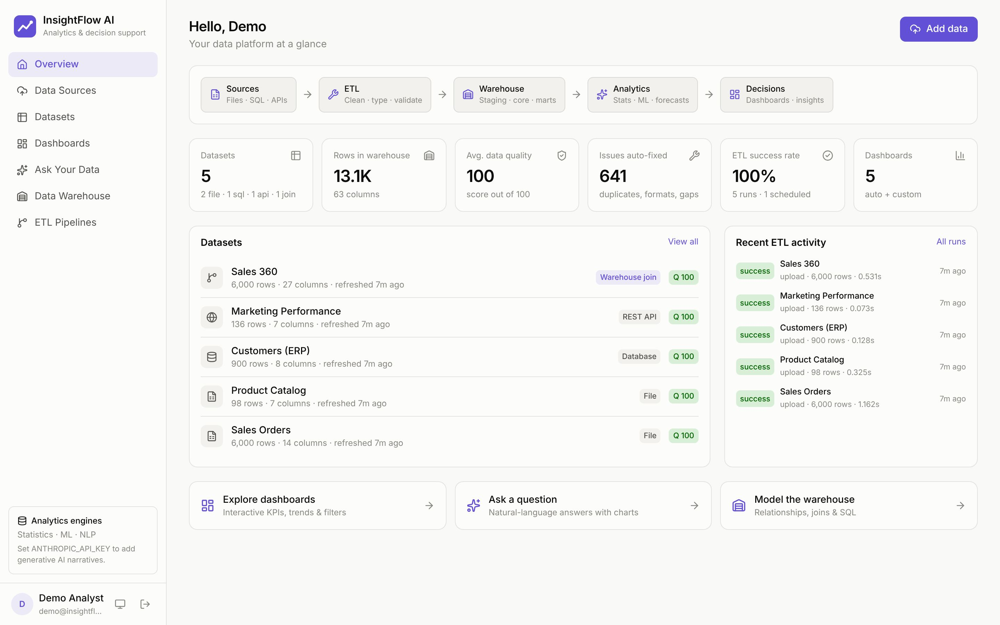 Overview | 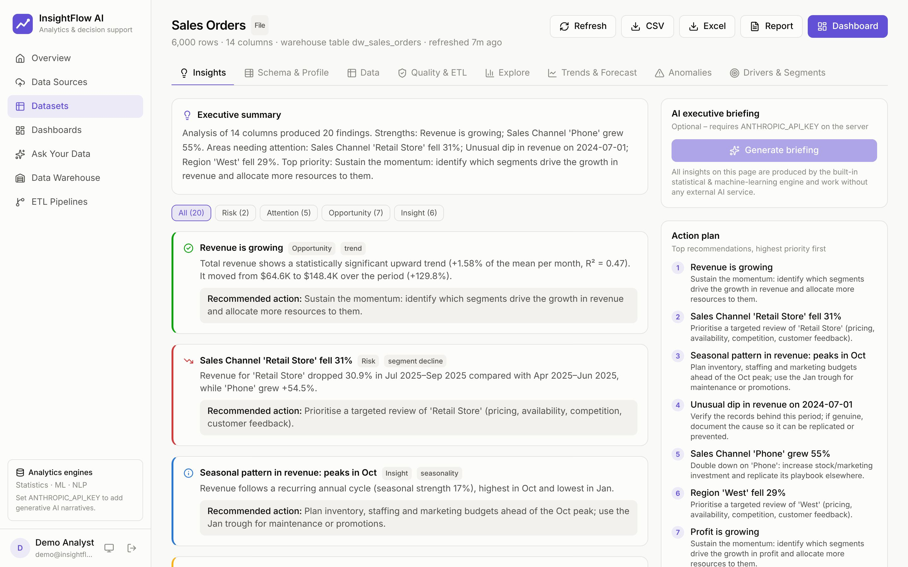 Insights & recommendations |
| 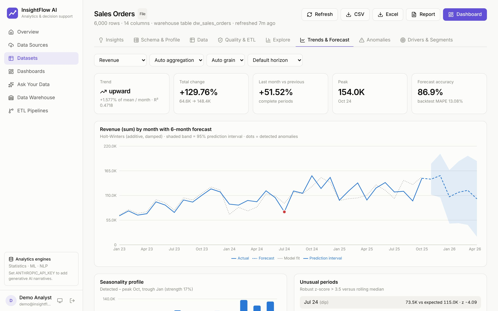 Trends & Holt-Winters forecast | 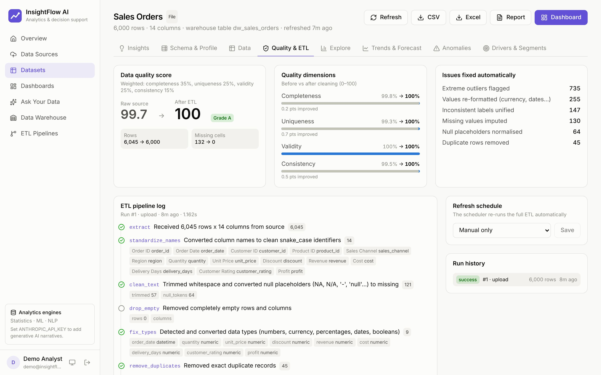 Data quality & ETL log |
| 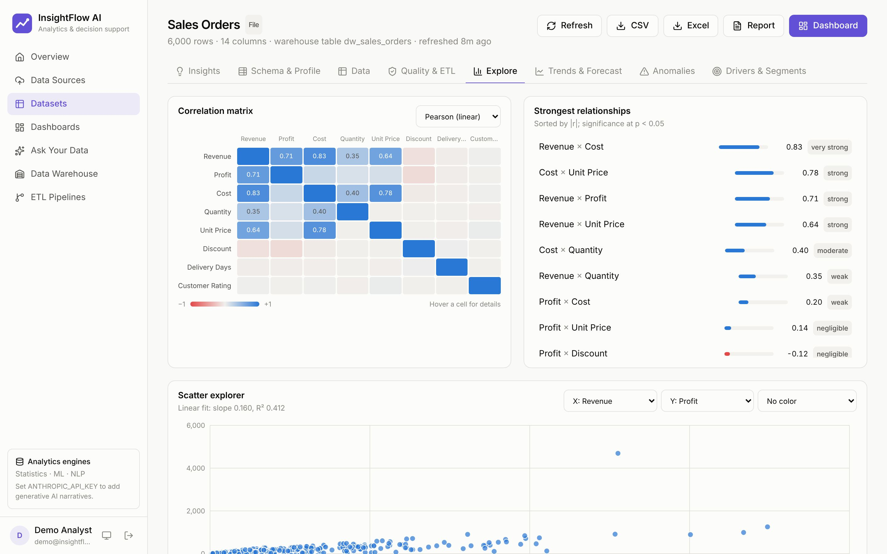 Correlations & distributions | 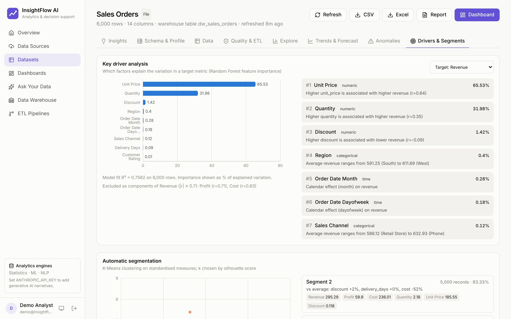 Key drivers & segmentation |
| 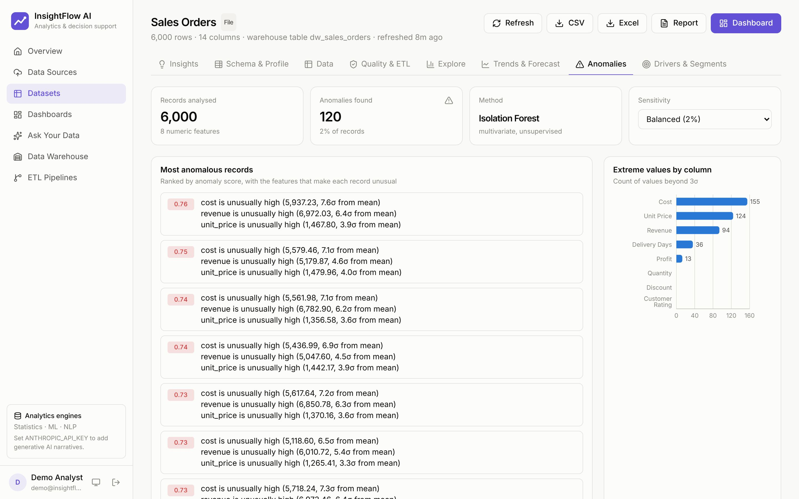 Anomaly detection | 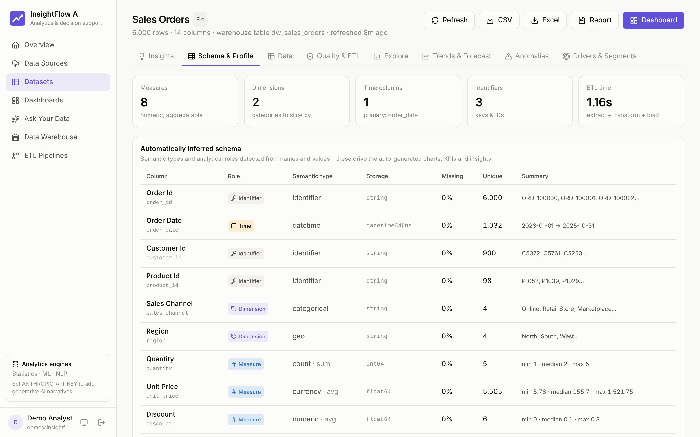 Inferred schema |
| 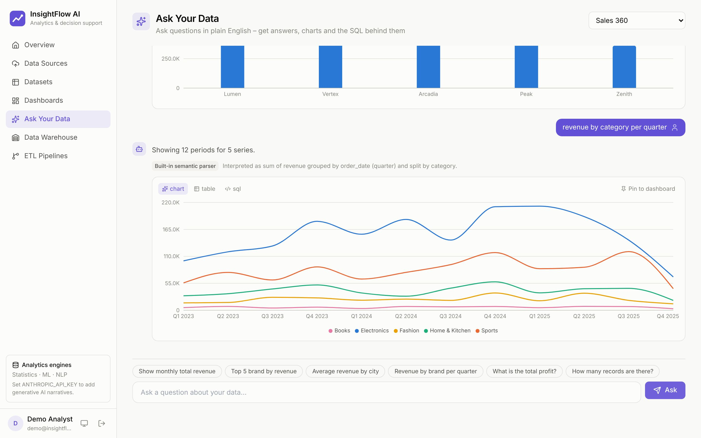 Ask your data | 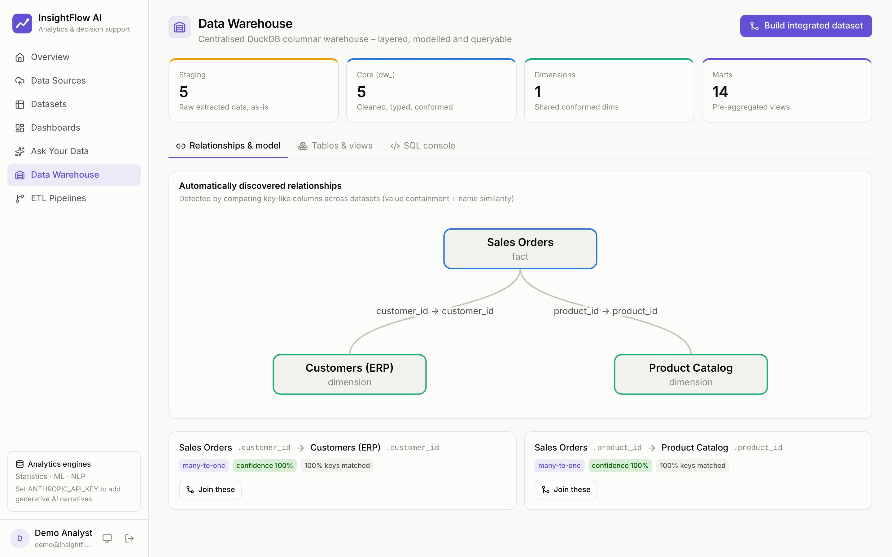 Warehouse & relationships |
| 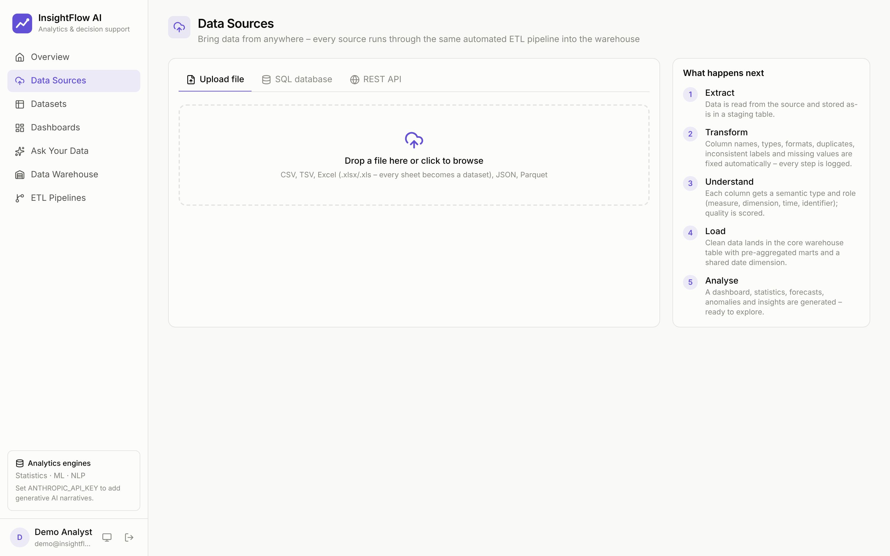 Data sources | 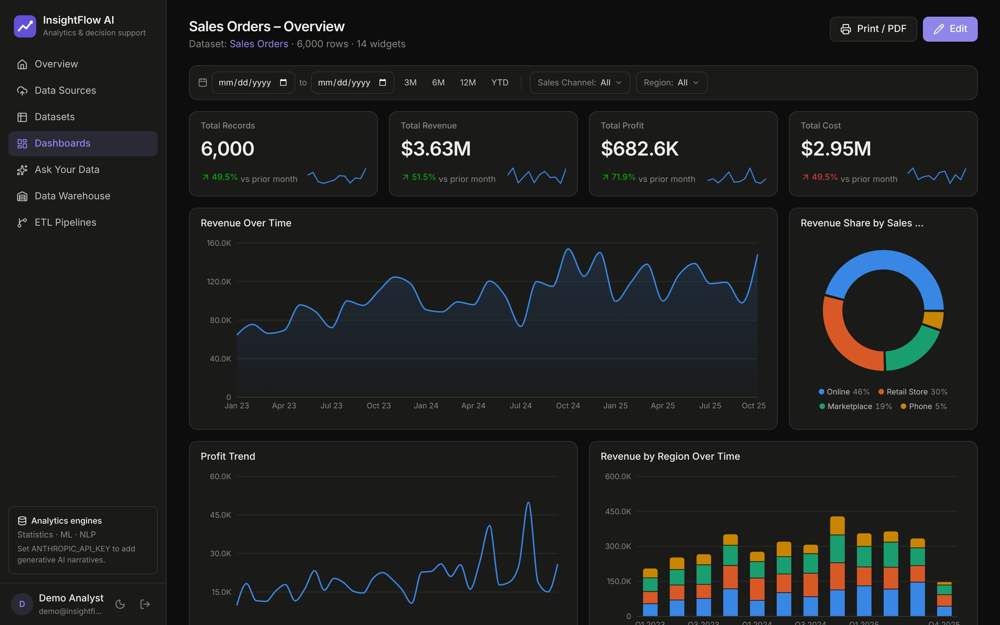 Dark mode |
