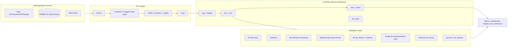
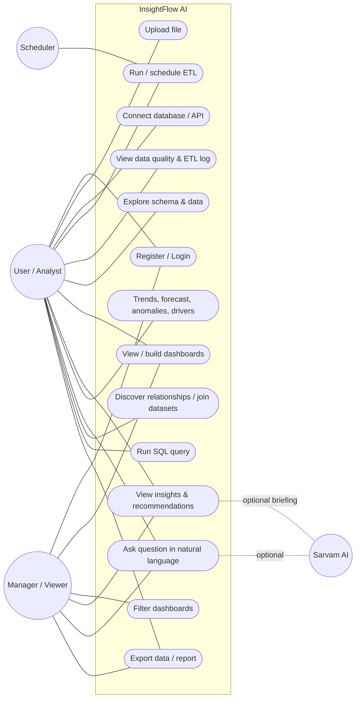
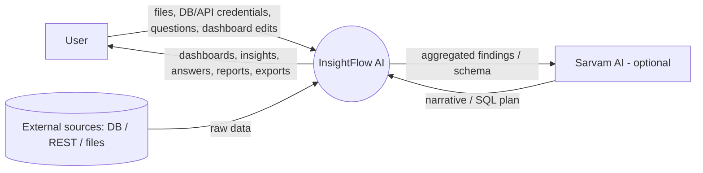
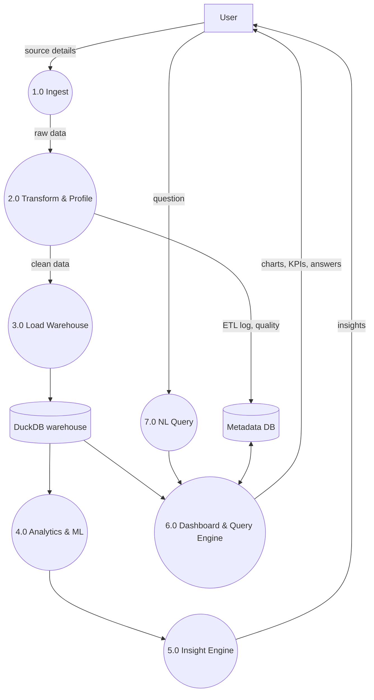
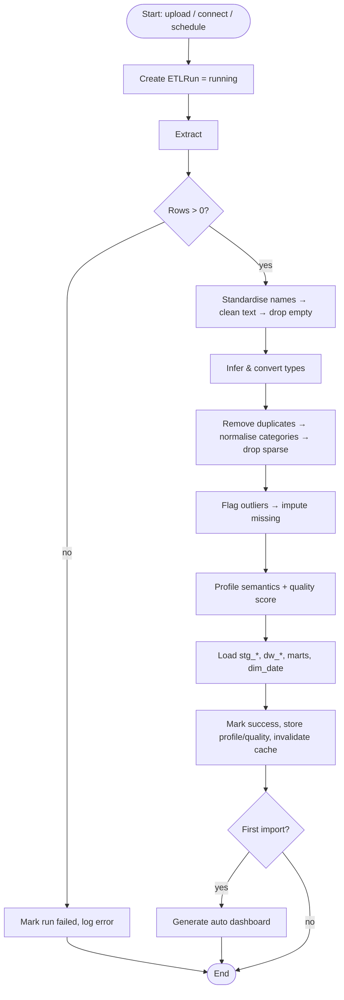
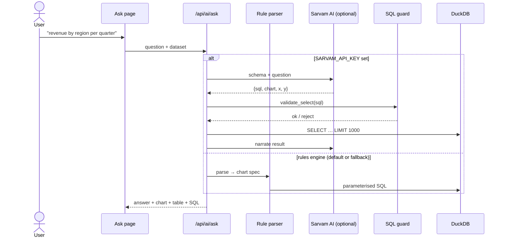
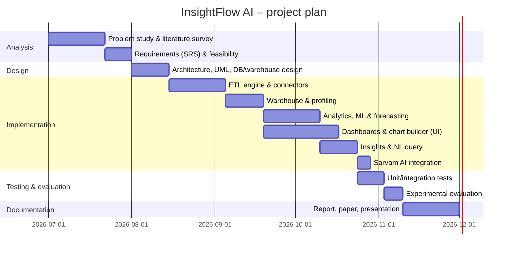

# InsightFlow AI: Context for the Research Paper and Project Report

This document collects everything needed to write (A) a research paper and (B) a final-year project report on InsightFlow AI. All numbers come from the actual system and from the reproducible evaluation in [`evaluation/RESULTS.md`](evaluation/RESULTS.md), which you can regenerate with `cd backend && python scripts/evaluate.py`.

> **Before you submit:**
> 1. Replace the `[placeholders]`: names, guide, college, dates and so on.
> 2. Re-run the evaluation on your own machine and use those numbers. Timings depend on hardware; accuracy figures should match because the seeds are fixed.
> 3. Check every reference against the original source (Google Scholar or the DOI) and follow your venue's citation style.
> 4. Write the final text in your own words. Use this document as source material, not as text to paste in.

---

## Contents

**Part 0: Project fact sheet**

**Part A: Research paper kit**
- A1 Titles · A2 Abstract · A3 Keywords · A4 Introduction · A5 Related work · A6 Methodology · A7 Contributions in detail · A8 Experimental setup · A9 Results and discussion · A10 Threats to validity · A11 Conclusion and future work · A12 Figures and tables · A13 References · A14 Paper template and venues

**Part B: Project report kit**
- B1 Report structure · B2 Introduction chapter · B3 Literature survey · B4 System analysis and SRS · B5 System design (UML, DFD, ER) · B6 Implementation · B7 Testing · B8 Results · B9 Conclusion · B10 Project management (timeline, COCOMO) · B11 User manual · B12 Glossary · B13 Viva questions

---

# Part 0: Project fact sheet

| Item | Value |
|---|---|
| Project title | **InsightFlow AI: An AI-Powered Universal Data Analytics, Visualization and Decision Support Platform** |
| Problem statement | "Modern Data Warehouse–Driven Decision Support and Analytics Framework with Power BI". This implementation replaces Power BI with custom-built dashboards. |
| Domain | Business intelligence, data warehousing, data engineering (ETL), applied machine learning, decision support systems, natural-language interfaces to data |
| Type | Full-stack web application (three-tier), self-hosted |
| Frontend | React 19, TypeScript 7, Vite 8, Tailwind CSS 3.4, Recharts 3, React Router 7, Axios, Lucide icons |
| Backend | Python 3.11+ (developed on 3.13), FastAPI, Uvicorn, Pydantic 2 |
| Data warehouse | DuckDB 2.0 (embedded columnar OLAP engine) |
| Metadata DB | SQLAlchemy 2.1 ORM on SQLite (PostgreSQL-ready) |
| Data / ML libraries | pandas 3.1, NumPy 2.5, SciPy 1.18, scikit-learn 1.9 |
| Connectors | SQLAlchemy (PostgreSQL, MySQL, SQL Server, SQLite…), requests (REST), openpyxl (Excel), pyarrow (Parquet) |
| Generative AI (optional) | Sarvam AI LLM `sarvam-105b` via the official `sarvamai` SDK |
| Security | JWT (HS256) and PBKDF2-HMAC-SHA256 (240,000 iterations), per-user isolation, SQL guard, DuckDB file access disabled |
| Deployment | Docker multi-stage image plus docker-compose, or a one-command script |
| Code size (non-blank lines) | Backend app 3,259 · frontend 3,172 · tests 247 · scripts (data generator and evaluation) 686 · **total about 7,360 LOC** |
| API | 46 REST endpoints in 6 routers (auth, datasets, analytics, dashboards, warehouse, ai), with automatic OpenAPI docs at `/docs` |
| UI | 10 pages plus 8 dataset analysis tabs, 12 widget/chart types, light and dark themes, responsive |
| Tests | 22 automated tests (pytest), all passing, plus an 8-experiment evaluation suite |
| Repository | `github.com/RITURAJ-techie/LastYear-Project` (branch `claude/magical-tesla-qj88kw`) |

**Headline results** (from `evaluation/RESULTS.md`):
- **ETL cleaning accuracy is 100%** on every injected fault type in 5,000 rows: 120/120 duplicates removed; currency strings, alternate date formats and inconsistent labels all corrected; null placeholders and invalid numbers isolated with 0 false positives. Cell agreement with ground truth went from 93.0% to 100%.
- **Semantic role inference:** 31/31 columns correct (100%).
- **Foreign-key discovery:** precision 1.00, recall 0.75, F1 0.86, in 0.02 s.
- **Anomaly detection:** the relationship-aware Isolation Forest (this project's contribution) scored **F1 0.50**, compared with 0.34 for plain Isolation Forest, 0.29 for the z-score baseline and 0.36 for the IQR baseline. Contextual-anomaly recall went from **0.06 to 0.47**.
- **Forecasting** (6-month horizon, 41 series): Holt-Winters had a **mean MAPE of 7.66%**, compared with 10.80% for seasonal naive, 14.31% for linear trend and 19.98% for naive. It was the best method on 31 of the 41 series, with MASE 0.79.
- **Natural-language questions** (rule-based parser, no LLM): 100% on the 32-question development set and **80% exact match on the 20-question held-out set**.
- **Scalability:** about 37,500 rows/s end-to-end ETL; **1,000,000 rows in 26.7 s**. Dashboard queries took 12–16 ms and correlations 309 ms at 1M rows. The full insight generation took about 4 s, roughly constant because of sampling.
- **Case study** (4 sources: CSV, Excel, SQL, REST): 641 data issues fixed automatically, 20 ranked insights generated, foreign keys discovered with 100% confidence.

---

# Part A: Research paper kit

## A1. Title options
1. *InsightFlow AI: An Automated, Warehouse-Centric Framework for Insight Generation and Decision Support from Heterogeneous Data*
2. *From Raw Data to Recommended Actions: A No-Code Data Warehouse and Machine-Learning Pipeline for Business Decision Support*
3. *Automated ETL, Schema Understanding and Explainable Insight Generation for Self-Service Business Intelligence*
4. *A Relationship-Aware Anomaly Detection and Automatic Insight Framework over an Embedded Columnar Data Warehouse*

## A2. Abstract (about 230 words; adapt to your venue's limit)

> Organisations store business data across databases, spreadsheets and external applications. Fragmentation, manual preparation and inconsistent quality delay reliable insight, and conventional business-intelligence tools still require users to model data and design every report. We present **InsightFlow AI**, an end-to-end framework that ingests heterogeneous sources (CSV/Excel/JSON/Parquet files, relational databases and REST APIs), applies an auditable twelve-step ETL pipeline, and maintains a layered columnar data warehouse (staging, core, marts and a conformed date dimension) on DuckDB. The system infers semantic column types and analytical roles, discovers foreign-key relationships across datasets, and quantifies data quality. On top of the warehouse it automatically generates dashboards and combines statistical testing, Holt-Winters forecasting, a *relationship-aware* Isolation Forest, Random-Forest key-driver analysis and K-Means segmentation into ranked, plain-language insights with recommended actions. A rule-based semantic parser answers natural-language questions, and an optional large language model (Sarvam-105B) adds narrative briefings under SQL guardrails. In controlled experiments with injected faults, the pipeline corrected 100% of duplicates, format errors and label inconsistencies; role inference was 100% accurate; and foreign-key discovery reached an F1 of 0.86. Adding log-ratio features raised contextual-anomaly recall from 0.06 to 0.47 (F1 0.34 → 0.50). Holt-Winters achieved 7.7% mean MAPE across 41 series, and the question parser reached 80% exact match on a held-out set. ETL throughput was about 37,000 rows/s up to one million rows, with interactive queries under 20 ms.

## A3. Keywords / index terms
Data warehouse; ETL; business intelligence; decision support system; data quality; automated insight generation; anomaly detection; Isolation Forest; time-series forecasting; Holt-Winters; natural-language interface to databases; DuckDB; self-service analytics; explainable analytics.

## A4. Introduction material

### A4.1 Background
- Organisational data sits in operational databases, Excel/CSV exports and SaaS/APIs. Decision makers need one consistent, current view.
- The classic answer is a **data warehouse** (Kimball; Inmon) fed by **ETL**, with BI tools on top. This requires specialised skills: data engineering for ETL, dimensional modelling, and report design in tools such as Power BI or Tableau.
- The "last mile" (knowing *what* to look at and *what to do*) is still manual. Users have to explore charts themselves to find trends, anomalies and drivers.

### A4.2 Problem statement
Fragmented data, manual processing, inconsistent data quality and limited reporting make it hard to obtain timely and reliable business insight. What is needed is an integrated, automated platform that (i) collects data from multiple sources, (ii) performs ETL, (iii) maintains a centralised warehouse, and (iv) delivers interactive dashboards, KPIs, trend analysis and actionable insights.

### A4.3 Research gap
| Existing approach | What is missing |
|---|---|
| Commercial BI (Power BI, Tableau, Qlik) | Strong visualisation, but users model data and build reports themselves; cleaning is separate (Power Query) and manual; insights are optional add-ons; licence cost |
| Open-source BI (Apache Superset, Metabase) | Need an existing clean warehouse; no automated cleaning, profiling or insight generation |
| Data-wrangling research (Wrangler, Trifacta) | Interactive cleaning only; no warehouse, analytics or decision layer |
| Automated insight research (QuickInsights, Top-k insights, SeeDB, Voyager) | Assumes clean, single-table data; usually no ETL or data-quality step; recommendations are rarely actionable text |
| NL-to-SQL research (NaLIR, Seq2SQL, LLM text-to-SQL) | Focus on query translation; little integration with ETL, data quality, or safe execution |

**The gap:** few systems cover the *whole chain* (heterogeneous ingestion → auditable cleaning → warehouse modelling → schema and relationship understanding → automated, explainable analytics → recommended actions → natural-language access) in one self-hostable, no-code platform, with measured accuracy at each stage.

### A4.4 Research questions
- **RQ1:** How accurately can a rule-based, logged ETL pipeline detect and repair common data-quality faults without user input?
- **RQ2:** Can column semantics (measure, dimension, time, identifier) and cross-dataset foreign keys be inferred automatically and reliably enough to drive dashboard and model generation?
- **RQ3:** Does adding relationship (ratio) features improve unsupervised detection of contextual anomalies in business data compared with standard Isolation Forest and univariate baselines?
- **RQ4:** How accurate is automatic forecasting (grid-searched damped Holt-Winters) compared with standard baselines on business-like monthly series?
- **RQ5:** How well does a lightweight, LLM-free semantic parser answer typical business questions, and where does it fail?
- **RQ6:** Does the architecture (an embedded columnar warehouse) scale to millions of rows with interactive latency on commodity hardware?

### A4.5 Contributions (put a bulleted list in the paper)
1. **An end-to-end architecture** that unifies multi-source ingestion, a 12-step auditable ETL, a layered columnar warehouse, automatic schema and relationship understanding, analytics, an insight engine and natural-language access in one self-hostable system.
2. **A data-quality index** (completeness, uniqueness, validity, consistency) measured before and after ETL, with a full step-level transformation log.
3. **Containment-based foreign-key discovery** across independently ingested datasets, which feeds a one-click integrated (joined) dataset.
4. **A relationship-aware Isolation Forest** that adds log-ratio features for strongly correlated measures. It raised contextual-anomaly recall from 0.06 to 0.47 on controlled data.
5. **Component-aware key-driver analysis**, which excludes measures that are arithmetic components of the target (for example cost within revenue) so they are not reported as "drivers", and **polarity-aware insight rules** (lower-is-better metrics such as cost or delay).
6. **One declarative chart-specification engine** shared by auto dashboards, the user chart builder and NL answers. All three are compiled to parameterised SQL, which gives consistent and safe behaviour.
7. **Guarded LLM integration**: the model only sees aggregated findings and schema, and its generated SQL passes a read-only guard and runs on a database connection that cannot access files.
8. **A reproducible evaluation** of every stage with injected ground truth, baselines and a held-out question set.

## A5. Related work (write one paragraph per theme)

**Data warehousing and OLAP.** Kimball and Ross define dimensional modelling (facts, conformed dimensions, a date dimension). Inmon defines the enterprise warehouse. Chaudhuri and Dayal survey warehousing and OLAP technology. InsightFlow follows a layered (staging, core, marts) design with a conformed `dim_date`. It uses an embedded columnar engine (DuckDB; Raasveldt and Mühleisen, 2019) instead of a separate server, which suits small and medium organisations.

**ETL and data cleaning.** Vassiliadis surveys ETL technology. Rahm and Do classify data-quality problems (single-source and multi-source, schema-level and instance-level). Wrangler (Kandel et al., 2011) supports interactive transformation scripts. This project automates the common instance-level repairs (types, formats, duplicates, inconsistent labels, missing values) with a logged, configurable pipeline.

**Data quality assessment.** Wang and Strong define data-quality dimensions from the consumer's perspective. Batini et al. review assessment methodologies. Our index uses four measurable dimensions and reports them before and after cleaning.

**Data profiling and key discovery.** Abedjan, Golab and Naumann survey data profiling, including inclusion-dependency and foreign-key discovery. Zhang et al. and Rostin et al. study foreign-key discovery using value containment and learned features. We use a lightweight containment plus name-similarity score that suits interactive use.

**Automatic visualisation and insight discovery.** Mackinlay's APT automated the design of graphical presentations. SeeDB (Vartak et al.) recommends interesting visualisations. Voyager (Wongsuphasawat et al.) supports browsing of recommended charts. Tang et al. extract top-k insights from multi-dimensional data, and QuickInsights (Ding et al.) mines insights at scale; Microsoft's work in this area later became Power BI Quick Insights. Data2Vis (Dibia and Demiralp) learns visualisation generation. InsightFlow combines schema-driven chart selection with statistical and ML findings and adds a *recommended action* to each insight.

**Anomaly detection.** Isolation Forest (Liu, Ting and Zhou, 2008) isolates anomalies by random partitioning. Chandola et al. survey anomaly types, including *contextual* anomalies. We show that a plain Isolation Forest misses relationship-breaking (contextual) records, and that ratio features improve recall.

**Forecasting.** Holt (1957/2004) and Winters (1960) introduced trend and seasonal exponential smoothing. Gardner reviewed damped-trend variants. Hyndman and Athanasopoulos describe evaluation with MAPE and MASE (Hyndman and Koehler, 2006).

**Natural-language interfaces to databases.** NaLIR (Li and Jagadish, 2014), Seq2SQL (Zhong et al., 2017) and the Spider benchmark (Yu et al., 2018) trace the field. Recent work uses LLMs. We use a deterministic semantic parser by default (no external dependency, transparent and safe) and an optional LLM with strict SQL guardrails.

**Comparison table** (use it in the paper; adjust ✓/✗ after checking current product documentation):

| Capability | Power BI | Tableau | Superset / Metabase | Wrangler / Trifacta | QuickInsights-style | **InsightFlow AI** |
|---|---|---|---|---|---|---|
| Multi-source ingestion | ✓ | ✓ | ✓ (SQL) | ✓ | ✗ | ✓ |
| Automatic cleaning with audit log | Partial (manual Power Query) | Partial (Prep) | ✗ | Interactive | ✗ | ✓ |
| Data-quality score | ✗ | ✗ | ✗ | Partial | ✗ | ✓ |
| Built-in warehouse layers | ✗ | ✗ | ✗ | ✗ | ✗ | ✓ |
| Automatic FK discovery across sources | Partial (relationship auto-detect) | ✗ | ✗ | ✗ | ✗ | ✓ |
| Auto-generated dashboards | Partial | Partial | ✗ | ✗ | ✓ | ✓ |
| Forecast, anomaly and driver analysis | Partial (some premium features) | Partial | ✗ | ✗ | ✓ | ✓ |
| Actionable recommendations | ✗ | ✗ | ✗ | ✗ | ✗ | ✓ |
| NL questions | ✓ (Q&A/Copilot) | ✓ | ✗ | ✗ | ✗ | ✓ |
| Self-hosted, open source, no licence fee | ✗ | ✗ | ✓ | ✗ | ✗ | ✓ |

## A6. Methodology (system and algorithms)

### A6.1 Architecture (Figure 1)


### A6.2 ETL pipeline (Algorithm 1)
```
Algorithm 1  AutoETL(source, options)
 1  R ← Extract(source)                       ▹ file / SQL / REST → DataFrame
 2  log ← []
 3  D ← StandardiseNames(R)                   ▹ snake_case, unique
 4  D ← CleanText(D)                          ▹ trim; {NA, N/A, null, -, ?, …} → ∅
 5  D ← DropEmptyRowsCols(D)
 6  for each text column c in D:
 7      if values(c) ⊆ {yes,no,true,false,…}: c ← Boolean(c)
 8      elif ParseNumeric(c) succeeds on ≥ 90% of non-null: c ← Numeric(c)   ▹ $, ₹, €, commas, %, (x)
 9      elif DateLike(c) and ParseDate(c) succeeds on ≥ 90%: c ← Datetime(c)
10  D ← RemoveExactDuplicates(D)
11  for each low-cardinality text column c:   ▹ category normalisation
12      group values by key(v)=lower(collapse_ws(v)); map group → most frequent spelling
13  D ← DropColumns(missing ratio > 0.95)
14  flag/cap values outside [Q1 − 3·IQR, Q3 + 3·IQR]
15  impute: numeric → median, categorical → "Unknown", boolean → mode, dates untouched
16  Π ← Profile(D); Q ← QualityIndex(R, D)
17  Load stg_*(R as text), dw_*(D); create mart views; extend dim_date
18  return D, Π, Q, log
```

### A6.3 Semantic role inference
A rule cascade over the name lexicon and value statistics (cardinality ratio *u/n*, integrality, value range, mean string length, email pattern):
- datetime → *time*; integer named like a year with values from 1900 to 2100 → *time*
- numeric with an id-like name and (*u/n* > 0.5 or *u* > 50) → *identifier*; {0,1} → *dimension* (boolean)
- otherwise numeric → *measure*, with sub-types currency, percentage, count or numeric; default aggregation is AVG for rate/price/score/duration names and SUM otherwise
- text: email → identifier; geographic name → dimension (geo); *u* ≤ max(30, 0.05*n*) → dimension; mean length ≥ 40 → text; near-unique → identifier

### A6.4 Data Quality Index
$$Q = 100\,(0.35\,C + 0.25\,U + 0.25\,V + 0.15\,K)$$
- $C = 1 - \frac{\text{missing cells}}{\text{cells}}$ (null placeholders count as missing)
- $U = 1 - \frac{\text{duplicate rows}}{\text{rows}}$
- $V = 1 - \frac{\text{unparseable values}}{\text{cells}}$
- $K = 1 - \frac{\text{inconsistent labels} + \text{re-formatted values}}{\text{cells}}$

### A6.5 Foreign-key discovery
For candidate columns $A.x$ (key-like) and $B.y$ (unique and complete in $B$):
$$\text{containment} = \frac{|\text{distinct}(A.x) \cap \text{distinct}(B.y)|}{|\text{distinct}(A.x)|}, \qquad \text{conf} = 0.7\cdot\text{containment} + 0.3\cdot\text{sim}(x, y)$$
A relationship is accepted when containment ≥ 0.5 and (name similarity ≥ 0.6 or both columns are identifiers). sim is the difflib SequenceMatcher ratio on normalised names. Cardinality is one-to-one if $A.x$ is also unique, otherwise many-to-one. Lineage links (a joined dataset and its own sources) are excluded.

### A6.6 Trend, seasonality and forecasting
- **Grain** is chosen from the date span (≤ 92 days → day, ≤ 200 → week, ≤ 12 years → month, else year). Gaps are filled. A **partial final period** (additive metric below 60% of the trailing 3-period mean) is excluded.
- **Trend:** OLS $y_t = \beta_0 + \beta_1 t$; significant if $p < 0.05$. The slope is reported as a percentage of the mean per period.
- **Seasonality strength:** coefficient of variation of the per-season means. Detected if > 0.08.
- **Additive damped Holt-Winters** (season $m$, damping $\phi = 0.95$):
$$\ell_t = \alpha(y_t - s_{t-m}) + (1-\alpha)(\ell_{t-1} + \phi b_{t-1})$$
$$b_t = \beta(\ell_t - \ell_{t-1}) + (1-\beta)\phi b_{t-1}$$
$$s_t = \gamma(y_t - \ell_t) + (1-\gamma)s_{t-m}$$
$$\hat y_{t+h} = \ell_t + (\textstyle\sum_{i=1}^{h}\phi^i)\,b_t + s_{t+h-m}$$
  α ∈ {0.2, 0.4, 0.6, 0.8}, β ∈ {0.05, 0.15, 0.3} and γ ∈ {0.1, 0.3, 0.5} are chosen by grid search to minimise one-step-ahead SSE. The method falls back to damped Holt when there are fewer than 2*m* observations. The 95% band is $\hat y \pm 1.96\,\sigma\sqrt{h}$.
- **Period anomalies:** robust z-score $z = 0.6745\,(y - \text{rolling median})/\text{MAD}$, flagged when $|z| > 3.5$.

### A6.7 Relationship-aware Isolation Forest (contribution)
Standard Isolation Forest isolates points that are extreme on some axis. A record can break a normal *relationship* (for example cost ≈ 0.65 × revenue) while each value stays within its normal range. We add, for every pair of strictly positive measures with $|r| \ge 0.7$ (top 10 pairs), the feature
$$f_{ab} = \log a - \log b$$
which turns a broken ratio into an extreme value on one axis. Features are standardised, and an Isolation Forest (200 trees, contamination 2%) produces anomaly scores $s(x) = 2^{-E[h(x)]/c(n)}$. Each flagged record is explained by its top-3 |z| features, for example "the revenue to cost ratio is unusually low (0.55×, 6.1σ)".

### A6.8 Key-driver analysis (component-aware)
A Random Forest regressor (150 trees, depth ≤ 10, min leaf 5) uses numeric measures, one-hot categories (2–40 levels) and calendar features (month, weekday). Impurity importances are summed back to the original columns. **Measures with $|r| \ge 0.7$ to the target are excluded** and reported as "components" (for example cost and profit for revenue), so actionable drivers such as unit price and quantity appear instead of accounting identities.

### A6.9 Segmentation
Measures are standardised and K-Means is run for *k* = 2…6, keeping the *k* with the best silhouette score (Rousseeuw, 1987) on a sample of up to 3,000 points. Segments are profiled by their percentage deviation from the overall mean, with a 2-D projection on the first two principal components.

### A6.10 Insight and recommendation engine
Each rule emits *(type, severity, title, description, recommendation, score)*:
- **Trend:** significant up or down; polarity flips for lower-is-better metrics (cost, delay, discount, churn…).
- **Large last-period change:** more than 15%.
- **Seasonality peak/trough** and **forecast summary**, including backtest MAPE.
- **Period anomaly** and **record anomalies**.
- **Concentration:** top category ≥ 40% of the total, plus Pareto share.
- **Segment movers:** last 3 complete months vs the previous 3, ±10% thresholds, ignoring segments under 1% of the total.
- **Significant correlations:** 0.5 ≤ |r| < 0.995, p < 0.05.
- **Top key driver** and **data quality**.

The score is base weight × measure rank × magnitude. The top items form the executive summary and action plan.

**Guards against misleading insights:**
- Time-based claims are skipped when there are fewer than 5 rows per period. For example, a 98-row product catalogue spread over 57 launch months would otherwise produce noise "seasonality" and "spikes".
- A key driver is only reported when the model explains at least 30% of the variation (R² ≥ 0.3).

**Multi-dataset (Insights Hub):**
- Each dataset's insights are computed in parallel (thread pool) and merged by score, with at most 4 per dataset in the headline list.
- Identical findings coming from an integrated dataset and its own sources are merged into one entry tagged with every dataset.
- A batch upload links its files with the FK discovery of A6.5 and builds an integrated dataset. The base is the "fact" dataset with the most many-to-one links, joined to each dataset it references.

### A6.11 Natural-language query processing
The deterministic parser has these stages:
1. Aggregation lexicon (total/average/how many/unique/max/min/median).
2. Time-grain lexicon (daily…yearly, "trend", "over time").
3. Top/bottom-N.
4. Column grounding: exact name, synonym table (sales → revenue, …) and fuzzy matching (ratio ≥ 0.85).
5. Grouping from "by/per/for each/across X".
6. Filters from literal category values and four-digit years.
7. Entity counting ("orders", "customers") as COUNT or COUNT DISTINCT.

The output is a chart spec compiled by the shared query engine into parameterised SQL. In optional LLM mode, the schema plus the question goes to Sarvam-105B, which returns JSON `{sql, chart, x, y}`. The SQL passes the read-only guard, runs with `LIMIT 1000` on a connection without file access, and the model narrates the result. Any failure falls back to the parser.

### A6.12 Safety of generated SQL
The guard allows a single statement starting with SELECT/WITH and blocks DDL/DML/PRAGMA/COPY/ATTACH/INSTALL/LOAD/SET/CALL…, system catalogs (`duckdb_*`, `information_schema`), file functions (`read_*`, `glob`) and other users' tables. Independently, DuckDB runs with `enable_external_access=false` and `lock_configuration=true`, which is defence in depth.

## A7. Contributions in detail (for the Discussion section)
- **Why the ratio features work:** Isolation Forest partitions one feature at a time on random splits. A relationship anomaly is not extreme on any single original axis, so it needs about as many splits as a normal point. On the log-ratio axis it sits far from the mass, so it is isolated in a few splits. The cost is that, with a fixed contamination budget (2%), some flag slots move from point anomalies to contextual ones (point recall 0.63 → 0.53), but overall F1 improves by 46%.
- **Why exclude components from driver analysis:** with revenue as the target, cost (r = 0.83) and profit (r = 0.71) take most of the importance, which is technically correct but useless as advice. After exclusion, unit price (65.5%) and quantity (32.0%) emerge, and these are levers a manager can act on.
- **Why use one query engine:** dashboards, the builder and NL answers share validation, parameterisation and semantics. A question answer can be pinned directly as a dashboard widget with no translation step.
- **Why make the LLM optional:** reproducibility, cost, privacy (data minimisation) and offline operation. The evaluation in this paper uses the deterministic engines only.

## A8. Experimental setup
| Item | Detail |
|---|---|
| Hardware | 4 vCPU Intel Xeon @ 2.10 GHz, 15 GB RAM, Linux (cloud VM). **Re-run on your machine and update.** |
| Software | Python 3.13, pandas 3.1, NumPy 2.5, scikit-learn 1.9, DuckDB 2.0 |
| Reproducibility | `backend/scripts/evaluate.py` with fixed seeds; outputs `docs/evaluation/results.json` and `RESULTS.md` |
| E1 Cleaning | 5,000 clean rows, 8 columns. Injected: 300 currency strings, 300 alternate date formats, 400 inconsistent labels, 250 null placeholders, 50 invalid numerics, 120 duplicate rows (5,120 rows total). Ground truth kept. |
| E2 Semantics | 31 synthetic columns covering 5 roles, including hard cases (integer IDs, booleans as 0/1, year, free text) |
| E3 Foreign keys | Star schema: orders (5,000) → customers (400), products (120), stores (15, named `code`), employees (60, integer `employee_no` referenced by `salesperson`); decoys (status, quantity) |
| E4 Anomalies | 5,000 rows × 5 correlated measures. 1% point anomalies (revenue and cost × 6–12) and 1% contextual anomalies (cost = 1.6–2.2 × revenue); 3 seeds. Baselines: plain iForest, any \|z\| > 3, any value beyond 3×IQR |
| E5 Forecasting | 40 synthetic 48-month series (level, slope, seasonal amplitude 5–35%, noise 2–10%) plus real demo revenue (34 months); last 6 months held out; MAPE, MASE (seasonal scaling *m* = 12) |
| E6 NLQ | Demo orders dataset (6,000 × 14). 32-question development set and 20-question **held-out** set written after the parser was frozen. Exact match requires measure, aggregation, grouping, time grain, filters and series all correct |
| E7 Scalability | Synthetic 12-column CSV, 10k–1M rows; end-to-end ETL and analytics latencies |
| E8 Case study | Bundled multi-source retail warehouse (CSV, Excel, SQL, REST) |

## A9. Results and discussion

**Table 1. Cleaning accuracy (E1).**

| Fault type | Injected | Result |
|---|---|---|
| Exact duplicate rows | 120 | 120 removed (100%) |
| Currency strings (`$1,234.50`) | 300 | 100% parsed to the exact value |
| Alternate date format (`YYYY/MM/DD`) | 300 | 100% correct |
| Inconsistent labels (`north`, ` NORTH `, …) | 400 | 100% normalised |
| Null placeholders (N/A, null, -, empty) | 250 | 100% recall, 0 false positives |
| Invalid numerics (abc, ??) | 50 | 100% recall, 0 false positives |
| Untouched cells preserved | – | 100% |
| Cell agreement with ground truth (region, revenue) | – | 93.0% → 100% |
| Column types detected | 7 | 7/7 |

*Discussion:* the rule-based repair handles common instance-level faults perfectly in this controlled setting. Real data contains faults outside these patterns (for example semantic errors and misspellings beyond case and whitespace), which this pipeline does not fix (see A10).

**Table 2. Role inference (E2):** 31/31 (100%): dimension 10/10, identifier 6/6, measure 10/10, text 2/2, time 3/3.

**Table 3. FK discovery (E3):** precision 1.00, recall 0.75, F1 0.86, in 0.02 s. The miss was `orders.salesperson → employees.employee_no`: an integer key with unrelated names. The integer `salesperson` column is profiled as a *currency measure* because its name contains the money keyword "sales", so it never becomes a key candidate. This illustrates how name lexicons can mislead. *Discussion:* there were no false positives (decoy integer columns were not linked). Recall could improve by also considering integer measures whose values are fully contained in a unique key column.

**Table 4. Anomaly detection (E4)** (mean of 3 seeds; 100 true anomalies in 5,000 rows):

| Method | Precision | Recall | F1 | Point recall | Contextual recall | Rows flagged |
|---|---|---|---|---|---|---|
| **Relationship-aware iForest (ours)** | **0.500** | **0.500** | **0.500** | 0.53 | **0.47** | 100 |
| Isolation Forest | 0.343 | 0.343 | 0.343 | 0.63 | 0.06 | 100 |
| z-score > 3 | 0.245 | 0.350 | 0.288 | 0.57 | 0.13 | 144 |
| 3×IQR | 0.309 | 0.440 | 0.362 | 0.65 | 0.23 | 143 |

*Discussion:* the main gain is on contextual anomalies (7.8× recall). The univariate baselines flag more rows, which raises their recall at the cost of precision. Point-anomaly recall is limited partly because heavy-tailed prices (log-normal) produce many legitimately extreme records, which compete for the 2% budget.

**Table 5. Forecasting (E5)** (6-month horizon, 41 series):

| Method | Mean MAPE % | Median MAPE % | Mean MASE | Best on # series | Demo revenue MAPE % |
|---|---|---|---|---|---|
| Naive | 19.98 | 19.09 | 2.203 | 1 | 19.23 |
| Seasonal naive | 10.80 | 11.18 | 1.122 | 7 | 14.76 |
| Linear trend | 14.31 | 13.69 | 1.555 | 2 | 14.21 |
| **Holt-Winters (ours)** | **7.66** | **7.32** | **0.789** | **31** | 15.14 |

*Discussion:* Holt-Winters wins clearly on series with a stable seasonal structure (MASE < 1 means it beats in-sample seasonal naive). On the short, noisy real demo series (34 months with injected spikes), all methods score 14–15% MAPE and linear trend is marginally best. This is honest evidence that model selection or ensembling would help (future work).

**Table 6. NL question understanding (E6)** (rule-based, no LLM):

| Component | Development (32 q) | Held-out (20 q) |
|---|---|---|
| **Exact match** | **100%** | **80%** |
| Measure | 100% | 90% |
| Aggregation | 100% | 80% |
| Grouping | 100% | 100% |
| Time grain | 100% | 100% |
| Filters | 100% | 100% |
| Series | 100% | 100% |

*Error analysis (held-out):*
- "lowest delivery days by sales channel" and "highest unit price": superlatives were read as ranking words, not MIN/MAX.
- "how many customers per region": parsed as COUNT(*) instead of COUNT(DISTINCT customer_id).
- "unique products sold": "products" was not grounded to `product_id` because there is no synonym and fuzzy matching failed.

All of these are lexicon or grounding issues. Structure (grouping, grain, filters, series) was always correct. *This motivates combining the parser with the LLM path for open-ended phrasing.*

**Table 7. Scalability (E7).**

| Rows | CSV MB | ETL total s | Rows/s | Monthly chart ms | Grouped series ms | Correlations ms | Trend+forecast ms | Anomalies ms | Full insights s |
|---|---|---|---|---|---|---|---|---|---|
| 10,000 | 0.6 | 0.33 | 29,938 | 4.3 | 10.6 | 26.7 | 9.7 | 688 | 1.69 |
| 50,000 | 3.3 | 1.46 | 34,134 | 6.2 | 12.3 | 46.6 | 11.5 | 2,003 | 3.88 |
| 100,000 | 6.6 | 2.83 | 35,350 | 7.6 | 11.5 | 61.8 | 13.5 | 1,800 | 3.93 |
| 250,000 | 16.8 | 6.15 | 40,650 | 8.5 | 12.4 | 195.7 | 20.7 | 2,216 | 4.44 |
| 500,000 | 33.7 | 13.16 | 38,002 | 8.9 | 14.1 | 252.7 | 21.1 | 2,042 | 4.34 |
| 1,000,000 | 67.7 | 26.67 | 37,489 | 11.8 | 15.7 | 308.9 | 38.4 | 2,018 | 4.19 |

*Discussion:* ETL scales linearly (about 37k rows/s). The transform step accounts for about 86% of ETL time because it runs in pandas on a single core. Warehouse queries stay interactive (< 40 ms) at 1M rows thanks to columnar execution. ML analytics are bounded by sampling (50k rows for anomalies, 20k for drivers), so their latency is roughly constant (about 2 s and 4 s).

**Table 8. Case study (E8).**

| Source | Raw rows | Clean rows | Columns | Issues fixed | Quality before → after | ETL s |
|---|---|---|---|---|---|---|
| Sales Orders (CSV) | 6,045 | 6,000 | 14 | 641 | 99.7 → 100.0 | 0.26 |
| Product Catalog (Excel) | 98 | 98 | 7 | 0 | 100 → 100 | 0.03 |
| Customers (SQL DB) | 900 | 900 | 8 | 0 | 100 → 100 | 0.05 |
| Marketing (REST API) | 136 | 136 | 7 | 0 | 100 → 100 | 0.02 |

The 641 fixes break down as: 45 duplicates, 147 inconsistent labels, 255 re-formatted values, 64 null placeholders and 130 imputed values. The system generated 20 insights (7 positive, 6 informational, 5 warnings, 2 risks). Examples:
- revenue growing (significant upward trend, R² 0.47, +130%);
- an October seasonal peak;
- an unusual July 2024 dip (robust z = −4.1);
- the Retail Store channel down 31% and the West region down 29% quarter-on-quarter;
- key drivers unit price (65.5%) and quantity (32.0%), with cost and profit excluded as components;
- 2% anomalous records;
- 2 customer segments (silhouette 0.37);
- relationships `orders.customer_id → customers` and `orders.product_id → products` found with 100% containment.

## A10. Threats to validity and limitations
- **Synthetic ground truth:** E1–E5 use generated data with known faults. Real-world error distributions are broader, and the results show the method works under controlled conditions rather than guaranteeing field accuracy.
- **Benchmark authorship:** the NLQ sets were written by the developers. The held-out set reduces, but does not remove, this bias. A user study or a public benchmark (Spider-style) would be stronger.
- **Single hardware configuration** for timings.
- **Quality index weights** are expert-chosen, not learned or validated with users.
- **Rule-based cleaning** does not fix semantic errors, typos beyond case and whitespace, or cross-field constraints.
- **Univariate forecasting** without external regressors or automatic model selection.
- **Single-process embedded warehouse:** large multi-user deployments would need a server engine.
- **No formal user study** of decision quality or time saved yet. Proposed as future work: a SUS questionnaire plus task-completion time against Excel or Power BI.

## A11. Conclusion and future work (draft)
> InsightFlow AI shows that the full chain from heterogeneous raw data to ranked, actionable recommendations can be automated in a self-hosted platform. It combines an auditable ETL pipeline, a layered columnar warehouse, automatic schema and relationship understanding, and explainable statistical and ML analytics. Controlled experiments show reliable repair of common data faults, accurate role inference, precise foreign-key discovery, a substantial gain in contextual-anomaly detection from relationship features, competitive forecasting, and interactive performance at the million-row scale.
>
> **Future work:** adaptive and ensemble forecasting with external regressors; learned (rather than hand-tuned) insight ranking from user feedback; detection of inclusion dependencies on integer keys; incremental/CDC loads with slowly changing dimensions; LLM-assisted cleaning of semantic errors; a controlled user study measuring time-to-insight and decision accuracy; and multilingual (Indic-language) question answering using Sarvam models.

## A12. Figures and tables for the paper
| # | Content | Source |
|---|---|---|
| Fig. 1 | System architecture | Mermaid in A6.1 (export to PNG/SVG with mermaid.live) |
| Fig. 2 | ETL pipeline with the per-step log | `docs/screenshots/06-quality-etl.jpg` |
| Fig. 3 | Auto-generated dashboard | `docs/screenshots/03-dashboard.jpg` |
| Fig. 4 | Insights and recommendations | `docs/screenshots/04-insights.jpg` |
| Fig. 5 | Forecast with prediction band | `docs/screenshots/05-forecast.jpg` |
| Fig. 6 | Discovered relationships (ER) | `docs/screenshots/12-warehouse.jpg` |
| Fig. 7 | NL question answering | `docs/screenshots/11-ask.jpg` |
| Fig. 8 | Scalability plot (ETL seconds vs rows, query ms vs rows) | Plot from `evaluation/results.json` → `E7_scalability` |
| Fig. 9 | Bar chart of anomaly F1 and contextual recall by method | `evaluation/results.json` → `E4_anomalies` |
| Tables 1–8 | Section A9 | `evaluation/RESULTS.md` |

Quick plotting snippet (matplotlib) for Figures 8 and 9:
```python
import json, matplotlib.pyplot as plt
R = json.load(open("docs/evaluation/results.json"))
s = R["E7_scalability"]
plt.figure(); plt.plot([r["rows"] for r in s], [r["etl_total_s"] for r in s], marker="o")
plt.xlabel("Rows"); plt.ylabel("ETL time (s)"); plt.grid(alpha=.3); plt.savefig("fig8_etl.png", dpi=300)
a = R["E4_anomalies"]["results"]
plt.figure(); plt.bar(list(a), [v["f1"] for v in a.values()]); plt.ylabel("F1"); plt.xticks(rotation=20)
plt.tight_layout(); plt.savefig("fig9_anomaly_f1.png", dpi=300)
```

## A13. References (check each one before citing)
1. R. Kimball and M. Ross, *The Data Warehouse Toolkit: The Definitive Guide to Dimensional Modeling*, 3rd ed. Wiley, 2013.
2. W. H. Inmon, *Building the Data Warehouse*, 4th ed. Wiley, 2005.
3. S. Chaudhuri and U. Dayal, "An overview of data warehousing and OLAP technology," *ACM SIGMOD Record*, vol. 26, no. 1, pp. 65–74, 1997.
4. M. Raasveldt and H. Mühleisen, "DuckDB: an embeddable analytical database," in *Proc. ACM SIGMOD*, 2019.
5. P. Vassiliadis, "A survey of extract–transform–load technology," *Int. J. Data Warehousing and Mining*, vol. 5, no. 3, 2009.
6. E. Rahm and H. H. Do, "Data cleaning: Problems and current approaches," *IEEE Data Engineering Bulletin*, vol. 23, no. 4, 2000.
7. R. Y. Wang and D. M. Strong, "Beyond accuracy: What data quality means to data consumers," *J. Management Information Systems*, vol. 12, no. 4, 1996.
8. C. Batini, C. Cappiello, C. Francalanci and A. Maurino, "Methodologies for data quality assessment and improvement," *ACM Computing Surveys*, vol. 41, no. 3, 2009.
9. S. Kandel, A. Paepcke, J. Hellerstein and J. Heer, "Wrangler: Interactive visual specification of data transformation scripts," in *Proc. ACM CHI*, 2011.
10. Z. Abedjan, L. Golab and F. Naumann, "Profiling relational data: a survey," *The VLDB Journal*, vol. 24, no. 4, 2015.
11. M. Zhang, M. Hadjieleftheriou, B. C. Ooi, C. M. Procopiuc and D. Srivastava, "On multi-column foreign key discovery," *PVLDB*, vol. 3, no. 1, 2010.
12. A. Rostin, O. Albrecht, J. Bauckmann, F. Naumann and U. Leser, "A machine learning approach to foreign key discovery," in *Proc. WebDB*, 2009.
13. J. Mackinlay, "Automating the design of graphical presentations of relational information," *ACM Trans. Graphics*, vol. 5, no. 2, 1986.
14. M. Vartak, S. Rahman, S. Madden, A. Parameswaran and N. Polyzotis, "SeeDB: Efficient data-driven visualization recommendations to support visual analytics," *PVLDB*, vol. 8, no. 13, 2015.
15. K. Wongsuphasawat et al., "Voyager: Exploratory analysis via faceted browsing of visualization recommendations," *IEEE TVCG*, vol. 22, no. 1, 2016.
16. B. Tang, S. Han, M. L. Yiu, R. Ding and D. Zhang, "Extracting top-k insights from multi-dimensional data," in *Proc. ACM SIGMOD*, 2017.
17. R. Ding, S. Han, Y. Xu, H. Zhang and D. Zhang, "QuickInsights: Quick and automatic discovery of insights from multi-dimensional data," in *Proc. ACM SIGMOD*, 2019.
18. V. Dibia and Ç. Demiralp, "Data2Vis: Automatic generation of data visualizations using sequence-to-sequence recurrent neural networks," *IEEE Computer Graphics and Applications*, 2019.
19. F. T. Liu, K. M. Ting and Z.-H. Zhou, "Isolation Forest," in *Proc. IEEE ICDM*, 2008.
20. V. Chandola, A. Banerjee and V. Kumar, "Anomaly detection: A survey," *ACM Computing Surveys*, vol. 41, no. 3, 2009.
21. L. Breiman, "Random forests," *Machine Learning*, vol. 45, no. 1, 2001.
22. P. J. Rousseeuw, "Silhouettes: A graphical aid to the interpretation and validation of cluster analysis," *J. Computational and Applied Mathematics*, vol. 20, 1987.
23. C. C. Holt, "Forecasting seasonals and trends by exponentially weighted moving averages," *Int. J. Forecasting*, vol. 20, no. 1, 2004 (reprint of the 1957 report).
24. P. R. Winters, "Forecasting sales by exponentially weighted moving averages," *Management Science*, vol. 6, no. 3, 1960.
25. E. S. Gardner Jr., "Exponential smoothing: The state of the art—Part II," *Int. J. Forecasting*, vol. 22, no. 4, 2006.
26. R. J. Hyndman and A. B. Koehler, "Another look at measures of forecast accuracy," *Int. J. Forecasting*, vol. 22, no. 4, 2006.
27. R. J. Hyndman and G. Athanasopoulos, *Forecasting: Principles and Practice*, 3rd ed. OTexts, 2021.
28. F. Li and H. V. Jagadish, "Constructing an interactive natural language interface for relational databases," *PVLDB*, vol. 8, no. 1, 2014.
29. V. Zhong, C. Xiong and R. Socher, "Seq2SQL: Generating structured queries from natural language using reinforcement learning," arXiv:1709.00103, 2017.
30. T. Yu et al., "Spider: A large-scale human-labeled dataset for complex and cross-domain semantic parsing and text-to-SQL task," in *Proc. EMNLP*, 2018.
31. F. Pedregosa et al., "Scikit-learn: Machine learning in Python," *JMLR*, vol. 12, 2011.
32. D. J. Power, *Decision Support Systems: Concepts and Resources for Managers*. Quorum Books, 2002.
33. B. Shneiderman, "The eyes have it: A task by data type taxonomy for information visualizations," in *Proc. IEEE Symp. Visual Languages*, 1996.
34. Sarvam AI, "Sarvam-105B and chat completions API," online documentation, docs.sarvam.ai (accessed [date]).
35. Microsoft, "Power BI documentation," learn.microsoft.com/power-bi (accessed [date]).

## A14. Paper template and suggested venues
- **Format:** IEEE conference template (two-column, 6–8 pages): Abstract → I. Introduction → II. Related Work → III. Proposed System (architecture, ETL, warehouse, intelligence layer) → IV. Methodology / Algorithms → V. Implementation → VI. Experimental Evaluation → VII. Discussion and Limitations → VIII. Conclusion → References.
- **Page budget (6 pages):** Introduction 0.75 · Related work 0.75 · System 1.25 · Algorithms 1.25 · Evaluation 1.5 · Discussion and conclusion 0.5.
- **Venue types to consider:** IEEE/Springer conferences on computing, data science and intelligent systems, and UGC-CARE or Scopus-indexed journals in computer applications. Check indexing, fees and the review process, and avoid predatory journals (check UGC-CARE and Scopus lists, and Think. Check. Submit.).

---

# Part B: Project report kit

## B1. Report structure (typical university format; follow your department's template)
**Front matter:**
1. Title page.
2. Certificate (guide/HOD).
3. Declaration.
4. Acknowledgement.
5. Abstract (use A2, adapted).
6. Table of contents, list of figures, list of tables.
7. List of abbreviations (see B12).

**Chapters:**
1. Introduction.
2. Literature survey.
3. System analysis (existing vs proposed system, feasibility, requirements/SRS).
4. System design (architecture, UML, DFD, ER, database and warehouse design, UI design).
5. Implementation (technologies, modules, algorithms, code highlights).
6. Testing (strategy, test cases, results).
7. Results and discussion (screenshots, evaluation).
8. Conclusion and future scope.

**Back matter:** References and appendices (user manual, installation guide, API list, sample code, evaluation tables, publication or certificate if any).

## B2. Chapter 1: Introduction

### 1.1 Overview
Use A4.1, plus a short description of the product, its users (business analysts, managers, students, SMEs) and its value: no-code analytics from raw data to decisions.

### 1.2 Problem statement
Use A4.2 verbatim.

### 1.3 Objectives
1. Ingest data from heterogeneous sources (files, databases, APIs).
2. Automate cleaning and transformation with a full audit trail.
3. Build and maintain a centralised, layered data warehouse.
4. Infer schema semantics and inter-dataset relationships automatically.
5. Measure data quality before and after processing.
6. Generate interactive dashboards and KPIs automatically and allow custom dashboards (replacing Power BI).
7. Provide trend, seasonality, forecast, anomaly, driver and segment analysis.
8. Convert analytical results into ranked insights with recommended actions.
9. Support natural-language questions with transparent SQL.
10. Ensure security, multi-user isolation, responsiveness and easy deployment.

### 1.4 Scope
- **In scope:** structured/tabular data; batch and scheduled refresh; single-organisation, multi-user web deployment; English-language questions.
- **Out of scope (current version):** streaming data, unstructured documents and images, real-time collaborative editing, row-level security policies, and native mobile apps (the UI is responsive instead).

### 1.5 Motivation
Problems with manual Excel consolidation, report backlogs and BI licence costs, and the need for decision support in SMEs and in education.

### 1.6 Organisation of the report
One line per chapter.

## B3. Chapter 2: Literature survey
Use A5. Many departments expect a **summary table**, for example:

| # | Author / year | Title (short) | Technique | Findings | Limitation / gap addressed by us |
|---|---|---|---|---|---|
| 1 | Kimball & Ross, 2013 | Data Warehouse Toolkit | Dimensional modelling | Star schemas, conformed dimensions | Manual modelling; we automate layers and the date dimension |
| 2 | Chaudhuri & Dayal, 1997 | DW & OLAP overview | OLAP architecture | Separation of OLTP and OLAP | Server-based; we use an embedded columnar engine |
| 3 | Raasveldt & Mühleisen, 2019 | DuckDB | Embedded vectorised OLAP | Fast analytics in-process | Engine only; we build the full BI stack on it |
| 4 | Rahm & Do, 2000 | Data cleaning | Taxonomy of quality problems | Single- and multi-source problems | Survey; we implement automated repairs |
| 5 | Kandel et al., 2011 | Wrangler | Interactive transformation | Faster wrangling | Needs a user for each step; ours is automatic |
| 6 | Wang & Strong, 1996 | Data quality | Quality dimensions | Consumer-centric DQ | No automated scoring; we compute an index |
| 7 | Abedjan et al., 2015 | Data profiling survey | Profiling, IND/FK discovery | Algorithms overview | Heavy algorithms; we use lightweight containment |
| 8 | Vartak et al., 2015 | SeeDB | Visualisation recommendation | Finds interesting views | Single table, no ETL |
| 9 | Ding et al., 2019 | QuickInsights | Insight mining | Automatic insights | No ETL or quality step, no actions |
| 10 | Liu et al., 2008 | Isolation Forest | Isolation-based anomalies | Efficient, unsupervised | Misses contextual anomalies; we add ratio features |
| 11 | Winters, 1960 / Hyndman, 2021 | Exponential smoothing | Holt-Winters | Strong seasonal forecasts | Parameter tuning; we grid-search automatically |
| 12 | Li & Jagadish, 2014 | NaLIR | NL interface to DBs | Interactive NL→SQL | Standalone; we integrate with BI and guard SQL |
| 13 | Yu et al., 2018 | Spider | Text-to-SQL benchmark | Cross-domain evaluation | Benchmark only |
| 14 | Microsoft Power BI docs | Power BI | Commercial BI | Rich visuals | Licence, manual modelling and report design |

## B4. Chapter 3: System analysis

### 3.1 Existing system
Manual Excel consolidation, or BI tools that need separate ETL, data modelling and report authoring. **Drawbacks:**
- time-consuming and error-prone;
- inconsistent quality;
- dependence on experts;
- static reports;
- no automated insight;
- licence cost.

### 3.2 Proposed system
InsightFlow AI. **Advantages:**
- automated ETL with an audit log;
- a centralised warehouse;
- automatic dashboards;
- ML-driven insights with actions;
- NL questions;
- open-source and self-hosted;
- secure.

### 3.3 Feasibility study
- **Technical:** mature open-source stack (Python, React, DuckDB). Runs on a laptop with 4 GB+ RAM.
- **Economic:** no licence cost. COCOMO estimate in B10. Hosting on one small VM or a local machine.
- **Operational:** web UI, no installation for end users, demo workspace, simple onboarding.
- **Legal and ethical:** data stays on premises. The optional LLM receives only aggregates and schema, never raw data rows.
- **Schedule:** feasible within one academic year (see the timeline in B10).

### 3.4 SDLC model
**Iterative/incremental (Agile)** with sprints for ETL, warehouse, analytics, dashboards, NLQ, AI integration, then testing and evaluation. Justification: requirements were refined as the analytics were validated.

### 3.5 Functional requirements (SRS)
| ID | Requirement |
|---|---|
| FR-01 | Users can register, log in and log out (JWT session) |
| FR-02 | Users can upload CSV, TSV, Excel (multi-sheet), JSON and Parquet files up to 200 MB |
| FR-03 | Users can connect to an SQL database, test the connection, list tables and import a table or a SELECT query |
| FR-04 | Users can import data from a REST API (JSON/CSV, records path, auth header) |
| FR-05 | The system runs ETL automatically on import and logs every step |
| FR-06 | Users can enable or disable individual cleaning rules per dataset |
| FR-07 | Users can schedule automatic refresh (15 min to weekly) and refresh manually |
| FR-08 | The system stores data in staging, core and mart layers with a date dimension |
| FR-09 | The system infers column semantic types and roles and shows the schema |
| FR-10 | The system computes a data-quality score before and after ETL |
| FR-11 | The system discovers relationships between datasets and lets users join them into a new dataset |
| FR-12 | The system generates a dashboard automatically for each dataset |
| FR-13 | Users can create, edit, resize, reorder and delete dashboard widgets (12 types) |
| FR-14 | Users can filter dashboards by date range and dimension values |
| FR-15 | The system provides distributions, correlations and a scatter/regression explorer |
| FR-16 | The system provides trend analysis, seasonality and forecasts with confidence bands |
| FR-17 | The system detects and explains anomalous records and periods |
| FR-18 | The system computes key drivers of a chosen metric and customer/record segments |
| FR-19 | The system generates ranked insights with recommended actions and an executive summary |
| FR-20 | Users can ask natural-language questions and get an answer, chart, table and SQL |
| FR-21 | Users can pin a question's answer to a dashboard |
| FR-22 | Users can run read-only SQL against their own warehouse tables |
| FR-23 | Users can export clean data (CSV/Excel/JSON) and an HTML analytics report, and print dashboards to PDF |
| FR-24 | With a Sarvam AI key, the system produces AI executive briefings and LLM text-to-SQL |
| FR-25 | Users can monitor all ETL runs (status, rows, duration, step log) |
| FR-26 | Users can upload up to 20 files in one batch; failed files are reported without stopping the batch |
| FR-27 | On batch upload, the system links related files by discovered keys and builds an integrated dataset automatically |
| FR-28 | Users can view combined, ranked and de-duplicated insights and an action plan across several datasets (Insights Hub) |

### 3.6 Non-functional requirements
| ID | Category | Requirement |
|---|---|---|
| NFR-01 | Performance | Dashboard widget queries under 100 ms at 1M rows (measured: 12–16 ms); ETL of at least 25k rows/s (measured: about 37k) |
| NFR-02 | Scalability | Handle at least 1M-row datasets on a 4-core / 8 GB machine |
| NFR-03 | Security | Hashed passwords, token authentication, per-user isolation, read-only SQL guard, no file access from SQL, redacted credentials |
| NFR-04 | Reliability | ETL failures are recorded without corrupting existing data; the AI degrades gracefully to built-in engines |
| NFR-05 | Usability | No-code workflow; demo workspace; responsive layout; light and dark themes; colour-blind-safe palette |
| NFR-06 | Maintainability | Modular packages (etl, analytics, routers), typed code, automated tests |
| NFR-07 | Portability | Runs on Windows, macOS and Linux; Docker image |
| NFR-08 | Transparency | Every chart and answer exposes its SQL; every ETL step is logged |
| NFR-09 | Privacy | Raw data never leaves the server; only aggregates and schema are sent to the LLM |

### 3.7 Hardware and software requirements
**Hardware:**
- Minimum: dual-core CPU, 4 GB RAM, 2 GB disk.
- Recommended: 4 cores, 8–16 GB RAM, SSD.

**Software:**
- OS: Windows 10+/macOS/Linux.
- One of the following:
  - Docker Desktop (Compose ≥ 2.24), or
  - Python ≥ 3.11 and Node.js ≥ 20.19.
- A modern browser (Chrome, Edge or Firefox).
- Optional: a Sarvam AI API key.

## B5. Chapter 4: System design

### 4.1 Architecture
Use Figure 1 (A6.1) and the three-tier description in `docs/ARCHITECTURE.md` §1.

### 4.2 Use case diagram


### 4.3 Data flow diagrams
**Level 0 (context):**

**Level 1:**


### 4.4 Activity diagram: ETL


### 4.5 Sequence diagram: upload to dashboard
```mermaid
sequenceDiagram
  actor U as User
  participant FE as React UI
  participant API as FastAPI
  participant ETL as ETL engine
  participant DW as DuckDB
  participant MD as Metadata DB
  U->>FE: Drop file, click "Upload & run ETL"
  FE->>API: POST /api/datasets/upload (multipart)
  API->>ETL: extract(file)
  ETL->>ETL: transform + profile + quality
  ETL->>DW: CREATE TABLE stg_x, dw_x; CREATE VIEW mart_x_*
  ETL->>MD: save Dataset(profile, quality), ETLRun(steps)
  API->>API: generate auto-dashboard widgets
  API->>MD: save Dashboard
  API-->>FE: dataset + run summary
  U->>FE: Open dashboard
  loop each widget
    FE->>API: POST /datasets/{id}/widget-data (spec + filters)
    API->>DW: parameterised SELECT
    DW-->>API: rows
    API-->>FE: chart data
  end
```

### 4.6 Sequence diagram: natural-language question


### 4.7 Class diagram (main backend components)

```mermaid
classDiagram
  class User { +id +email +name +password_hash }
  class Dataset { +id +name +table_name +source_type +source_config +etl_options +profile +quality +status +refresh_interval_minutes }
  class ETLRun { +id +trigger +status +rows_extracted +rows_loaded +steps +error }
  class Dashboard { +id +name +widgets +filters +is_auto }
  User "1" --> "*" Dataset
  User "1" --> "*" Dashboard
  Dataset "1" --> "*" ETLRun
  Dataset "1" --> "*" Dashboard
  class Extractor { +read_file() +read_sql() +read_api() }
  class Transformer { +transform(df, options) TransformResult }
  class Profiler { +infer_semantic() +profile_dataframe() +quality_report() }
  class Pipeline { +run_etl(dataset) ETLRun }
  class Warehouse { +load_dataframe() +query_df() +ensure_date_dimension() +list_objects() }
  class QueryEngine { +run_chart_query() +run_kpi_query() +run_table_query() }
  class Analytics { +distributions() +correlations() +trends.analyze() }
  class MLModels { +anomalies() +key_drivers() +clusters() +relationship_features() }
  class InsightEngine { +generate() +ai_narrative() }
  class NLQ { +rules_parse() +ai_answer() +answer() }
  class SQLGuard { +validate_select() }
  class SarvamClient { +available() +complete() }
  Pipeline --> Extractor
  Pipeline --> Transformer
  Pipeline --> Profiler
  Pipeline --> Warehouse
  QueryEngine --> Warehouse
  InsightEngine --> Analytics
  InsightEngine --> MLModels
  InsightEngine --> SarvamClient
  NLQ --> QueryEngine
  NLQ --> SQLGuard
  NLQ --> SarvamClient
```


### 4.8 ER diagram (metadata database)
```mermaid
erDiagram
  USERS ||--o{ DATASETS : owns
  USERS ||--o{ DASHBOARDS : owns
  DATASETS ||--o{ ETL_RUNS : has
  DATASETS ||--o{ DASHBOARDS : visualised_by
  USERS { int id PK; string email UK; string name; string password_hash; datetime created_at }
  DATASETS { int id PK; int owner_id FK; string name; string table_name UK; string source_type; json source_config; json etl_options; int row_count; int column_count; json profile; json quality; string status; int refresh_interval_minutes; datetime last_refreshed }
  ETL_RUNS { int id PK; int dataset_id FK; string trigger; string status; datetime started_at; datetime finished_at; int rows_extracted; int rows_loaded; json steps; text error }
  DASHBOARDS { int id PK; int owner_id FK; int dataset_id FK; string name; json widgets; json filters; int is_auto }
```

### 4.9 Warehouse (star) schema of the case study
```mermaid
erDiagram
  DW_SALES_ORDERS }o--|| DW_CUSTOMERS_ERP : customer_id
  DW_SALES_ORDERS }o--|| DW_PRODUCT_CATALOG : product_id
  DW_SALES_ORDERS }o--|| DIM_DATE : order_date
  DW_SALES_ORDERS { string order_id; date order_date; string customer_id; string product_id; string sales_channel; string region; int quantity; float unit_price; float discount; float revenue; float cost; int delivery_days; float customer_rating; float profit }
  DW_CUSTOMERS_ERP { string customer_id PK; string customer_name; string segment; string region; string city; date signup_date; int age; string loyalty_tier }
  DW_PRODUCT_CATALOG { string product_id PK; string product_name; string category; string sub_category; string brand; float list_price; date launch_date }
  DIM_DATE { date date_key PK; int year; int quarter; int month; string month_name; int week; int day_of_week; bool is_weekend; string year_month }
```

### 4.10 UI design (screens)
Login · Overview · Data Sources (File with single/batch upload, SQL, API tabs) · Insights Hub (combined insights) · Datasets · Dataset detail (Insights, Schema & Profile, Data, Quality & ETL, Explore, Trends & Forecast, Anomalies, Drivers & Segments) · Dashboards · Dashboard view/edit with chart builder · Ask Your Data · Data Warehouse (relationships, tables & views, SQL console) · ETL Pipelines. Screenshots are in `docs/screenshots/01…14`.

**Design principles:**
- a validated colour-blind-safe categorical palette in a fixed order;
- a diverging scale for correlations;
- hover tooltips on every chart;
- a legend whenever there are 2 or more series;
- a table and SQL view for every chart;
- no dual axes;
- light and dark themes;
- responsive layout down to phone width.

## B6. Chapter 5: Implementation

### 5.1 Technology justification
Use the "Why" column of the README tech-stack table.

### 5.2 Module to source file mapping
| Module | Backend files | Frontend files |
|---|---|---|
| Authentication | `app/auth.py`, `routers/auth.py` | `auth.tsx`, `pages/Login.tsx` |
| Data sources / extraction | `etl/extract.py`, `routers/datasets.py` | `pages/Sources.tsx` |
| ETL & profiling | `etl/transform.py`, `etl/profile.py`, `etl/pipeline.py`, `scheduler.py` | `pages/dataset/QualityTab.tsx`, `pages/Pipelines.tsx` |
| Warehouse | `warehouse.py`, `routers/warehouse.py`, `analytics/relationships.py`, `analytics/sqlguard.py` | `pages/Warehouse.tsx` |
| Query & dashboards | `analytics/query.py`, `analytics/dashboard.py`, `routers/dashboards.py` | `pages/Dashboards.tsx`, `pages/DashboardView.tsx`, `components/Widget.tsx`, `components/ChartBuilder.tsx`, `components/FilterBar.tsx`, `components/charts/*` |
| Statistics & trends | `analytics/stats.py`, `analytics/trends.py` | `pages/dataset/ExploreTab.tsx`, `pages/dataset/TrendsTab.tsx` |
| Machine learning | `analytics/ml.py` | `pages/dataset/AnomaliesTab.tsx`, `pages/dataset/DriversTab.tsx` |
| Insights & report | `analytics/insights.py`, `routers/analytics.py` | `pages/dataset/InsightsTab.tsx` |
| NL query & AI | `analytics/nlq.py`, `ai/llm.py`, `routers/ai.py` | `pages/Ask.tsx` |
| Infrastructure | `main.py`, `config.py`, `database.py`, `deps.py`, `services.py`, `seed.py` | `App.tsx`, `components/Layout.tsx`, `api.ts`, `hooks.ts`, `index.css` |

### 5.3 Code snippets worth including (short excerpts)
- `etl/transform.py`: `_parse_numeric` (currency and negative parsing) and the category normalisation block.
- `etl/profile.py`: `infer_semantic` (the rule cascade) and `quality_report`.
- `analytics/trends.py`: `holt_winters` and `_fit_best` (grid search).
- `analytics/ml.py`: `relationship_features` (the contribution) and the attribution in `anomalies`.
- `analytics/query.py`: `run_chart_query` (spec to parameterised SQL).
- `analytics/sqlguard.py`: `validate_select`.
- `ai/llm.py`: the Sarvam client with fallback.

### 5.4 API endpoints
See the README "REST API" table (46 endpoints). Include it as an appendix.

## B7. Chapter 6: Testing

### 6.1 Strategy
| Level | What | How |
|---|---|---|
| Unit | Cleaning rules, inference, query engine, forecasting, SQL guard, LLM client | pytest (`tests/test_etl.py`, `test_analytics.py`, `test_ai.py`) |
| Integration | API + ETL + warehouse + analytics end-to-end | FastAPI TestClient (`tests/test_api.py`) |
| System | Full UI flows in a real browser (light, dark, mobile) | Manual and Playwright screenshots |
| Security | Auth, isolation, SQL injection, file access | Automated tests + manual |
| Performance | ETL and query latency up to 1M rows | `scripts/evaluate.py` (E7) |
| Accuracy | Cleaning, inference, FK, anomalies, forecasting, NLQ | `scripts/evaluate.py` (E1–E6) |
| UAT | Demo walkthrough with users | Guide/peers; record feedback |

### 6.2 Test cases (the automated ones all pass; mark the manual ones after you run them)
| TC | Module | Test | Input | Expected | Result |
|---|---|---|---|---|---|
| TC-01 | Auth | Access without token | GET /api/datasets | 401 | Pass |
| TC-02 | Auth | Login valid / invalid | correct / wrong password | 200 token / 401 | Pass |
| TC-03 | ETL | Column names | "Order Date", "customerID" | order_date, customer_id | Pass |
| TC-04 | ETL | Messy values | "$1,200.50", "(50)", "N/A", "north " | 1200.5, −50, missing→imputed, "North" | Pass |
| TC-05 | ETL | Duplicates | 1 duplicate row | Removed, logged | Pass |
| TC-06 | Profiling | Semantic inference | id, revenue, segment, region, date, email | identifier, currency, categorical, geo, datetime, email | Pass |
| TC-07 | Profiling | Quality score | clean frame | 100, grade A | Pass |
| TC-08 | Query | Monthly grain | 2 years of daily data | 24 rows | Pass |
| TC-09 | Query | Series + date filter | quarter × region, 2023 | 4 rows, 3 series | Pass |
| TC-10 | Query | Invalid column | x = "nope" | QueryError | Pass |
| TC-11 | Forecast | Trend and horizon | rising seasonal series | "upward", 6 forecast points | Pass |
| TC-12 | Security | SQL guard | DROP, multi-statement, other table, read_csv, COPY | All rejected | Pass |
| TC-13 | Security | Warehouse file access | read_csv('/etc/passwd') | Permission error | Pass |
| TC-14 | API E2E | Upload → analyses → widgets → NLQ → SQL → export → report → refresh | sales.csv | All 200, 600 rows, 5 duplicates removed | Pass |
| TC-15 | Security | Cross-user isolation | user B reads A's dataset or table | 404 / 400 | Pass |
| TC-16 | Connector | SQL source | SQLite with 30 rows | Tables listed; 30 rows loaded | Pass |
| TC-17 | AI | Sarvam request shape | mocked SDK | Correct model, messages, effort; `<think>` stripped | Pass |
| TC-18 | AI | Fallbacks | 403 error, content filter, no key | Returns None, falls back to built-in engine | Pass |
| TC-19 | AI | LLM text-to-SQL | mocked plan | Validated, executed, narrated | Pass |
| TC-20 | AI | Malicious LLM SQL | "DROP TABLE …" plan | Rejected, rules engine answers | Pass |
| TC-21 | UI | Upload via drag and drop | orders.csv | Success card, links to dataset and dashboard | [Manual] |
| TC-22 | UI | Dashboard filters | Region = North, last 6M | All widgets update | [Manual] |
| TC-23 | UI | Chart builder | Bar, Revenue by Category | Live preview, saved after "Done" | [Manual] |
| TC-24 | UI | Theme and responsive | dark mode, 390 px width | Readable, no horizontal scroll | [Manual] |
| TC-25 | UI | Ask & pin | "revenue by region" → Pin | Widget appears on the dashboard | [Manual] |
| TC-26 | Scheduler | Auto refresh | interval 15 min | New run with trigger = schedule | [Manual] |
| TC-27 | Batch | Batch upload of 3 related CSVs + 1 PDF | orders, customers, products, notes.pdf | 3 datasets; PDF reported as failed; 2 links found; integrated dataset of 900 rows with joined attributes | Pass |
| TC-28 | Batch | Batch limits and integration off | 21 files; auto_integrate = false | 400 error; no integrated dataset | Pass |
| TC-29 | Insights Hub | Combined insights | 4 dataset ids | Totals, ranked insights tagged by dataset, relationships | Pass |

### 6.3 Results
22/22 automated tests pass (`pytest -q`). For accuracy and performance results, see B8 and A9.

## B8. Chapter 7: Results and discussion
- Screenshots `01–14` with captions:
  1. Login.
  2. Overview.
  3. Auto dashboard.
  4. Insights.
  5. Forecast.
  6. Quality & ETL log.
  7. Correlations & distributions.
  8. Drivers & segments.
  9. Anomalies.
  10. Inferred schema.
  11. Ask your data.
  12. Warehouse relationships.
  13. Data sources.
  14. Dark mode.
- Evaluation tables 1–8 (A9), each with a short discussion.
- Case study narrative: the demo retail company, the problems found and the insights generated (E8).
- Comparison with the existing system or Power BI (table in A5).

## B9. Chapter 8: Conclusion and future scope
Use A11. Future scope items:
1. Ensemble or auto-selected forecasting with external regressors.
2. Learned insight ranking from user feedback.
3. Integer-key inclusion-dependency discovery.
4. Incremental/CDC loads and slowly changing dimensions.
5. Role-based sharing and row-level security.
6. E-mail/Slack scheduled reports and KPI alerts.
7. More connectors (Google Sheets, Salesforce, S3/Azure Blob).
8. Indic-language questions with Sarvam models.
9. Drag-and-drop dashboard layout.
10. A user study (SUS score, time-to-insight).

## B10. Project management

### 10.1 Timeline (adjust dates to your semester)


### 10.2 Cost and effort estimation (COCOMO 81, organic mode)
- Size: about **7.36 KLOC** (non-blank lines: backend 3.26k + frontend 3.17k + tests 0.25k + scripts 0.69k).
- Effort: $E = 2.4 \times (7.36)^{1.05} \approx 19.5$ person-months.
- Development time: $T = 2.5 \times E^{0.38} \approx 7.7$ months.
- Average staff: $E/T \approx 2.5$ persons.
- Infrastructure cost: ₹0 in licences (open source). Optional costs: cloud VM hosting and Sarvam API usage (pay-per-use; check current pricing).

> COCOMO assumes industrial productivity. Explain in the report that the actual academic effort differed, and that open-source libraries reduced the code that had to be written.

### 10.3 Risk management
| Risk | Mitigation |
|---|---|
| Messy or unsupported data formats | Encoding fallback, delimiter sniffing, per-rule toggles, error logging |
| LLM unavailable, costly or unsafe | Optional layer, deterministic fallback, SQL guard, data minimisation |
| Performance with large files | Columnar warehouse, sampling for ML, analytics cache |
| Security breaches | Hashing, JWT, isolation tests, file access disabled in DuckDB |

## B11. Appendix: user manual (short)
1. **Start the app:** `docker compose up --build` and open http://localhost:8000 (see the README for other ways).
2. **Log in:** use `demo@insightflow.ai` / `demo1234`, or register a new account.
3. **Add data:** Data Sources → upload a file, or connect a database or REST API. Optionally adjust the ETL cleaning rules and schedule.
4. **Review quality:** Datasets → choose a dataset → Quality & ETL (score, issues, step log).
5. **Insights:** the Insights tab shows the executive summary, ranked insights and action plan. Click "Generate briefing" for a Sarvam AI narrative.
6. **Analyse:** use the Explore, Trends & Forecast, Anomalies and Drivers & Segments tabs.
7. **Dashboards:** Dashboards → open → filter. Click Edit → Add chart, resize or reorder widgets, then Done. Print / PDF is available.
8. **Ask:** Ask Your Data → type a question → switch between chart, table and SQL → Pin to dashboard.
9. **Warehouse:** view relationships → "Join these" to build an integrated dataset; browse tables and views; use the SQL console.
10. **Export:** CSV, Excel, JSON or the HTML report from the dataset header.

## B12. Glossary and abbreviations
| Term | Meaning |
|---|---|
| BI | Business Intelligence |
| DSS | Decision Support System |
| ETL | Extract, Transform, Load |
| DW | Data Warehouse |
| OLAP / OLTP | Online Analytical / Transaction Processing |
| Staging / core / mart | Warehouse layers: raw snapshot, cleaned conformed data, pre-aggregated views |
| Dimension / measure | Descriptive attribute (slice by) / numeric value (aggregate) |
| KPI | Key Performance Indicator |
| FK / PK | Foreign / Primary Key |
| DQ | Data Quality |
| IQR | Interquartile range |
| MAPE / MASE | Mean Absolute Percentage Error / Mean Absolute Scaled Error |
| iForest | Isolation Forest |
| RF | Random Forest |
| PCA | Principal Component Analysis |
| NLQ / NL2SQL | Natural-Language Query / text-to-SQL |
| LLM | Large Language Model |
| JWT | JSON Web Token |
| API / REST | Application Programming Interface / Representational State Transfer |
| SPA | Single-Page Application |
| CVD | Colour-vision deficiency (colour blindness) |

## B13. Likely viva questions (with short answers)
1. **Why DuckDB instead of MySQL or PostgreSQL for the warehouse?** DuckDB is a columnar, vectorised OLAP engine that runs in-process. It needs no server, is fast for aggregations (12 ms at 1M rows) and is ideal for a self-hosted analytics product. MySQL and PostgreSQL are row stores optimised for transactions (OLTP).
2. **What is the difference between the staging, core and mart layers?** Staging keeps the raw snapshot for audit. Core holds the cleaned, typed, conformed data used for analysis. Marts are pre-aggregated views for fast KPIs.
3. **How do you detect column types?** A ≥ 90% parse rule for numbers, dates and booleans, then a role cascade based on name lexicons and statistics such as cardinality, integrality and length (A6.3).
4. **How is the data quality score computed?** A weighted index of completeness, uniqueness, validity and consistency, measured before and after ETL (A6.4).
5. **How are relationships found automatically?** Value containment between key-like columns, where the target must be unique, combined with name similarity (A6.5).
6. **Why Isolation Forest, and what did you improve?** It is unsupervised, efficient and works without labels. We added log-ratio features so records that break a relationship, such as cost > revenue, can be isolated. Contextual recall rose from 0.06 to 0.47.
7. **Which forecasting method do you use and how is it tuned?** Additive damped Holt-Winters with α, β and γ grid-searched on one-step SSE. It beat naive, seasonal naive and linear trend on 31 of 41 series (mean MAPE 7.7%).
8. **How do you prevent SQL injection and dangerous queries?** All UI queries are parameterised with validated identifiers. Free SQL must pass a read-only guard, and DuckDB has external file access disabled and its configuration locked.
9. **What if the AI gives a wrong or harmful query?** It is validated by the guard. If it is rejected, or if the API fails, the deterministic parser answers. The AI only ever receives aggregates and schema.
10. **Why is the AI optional?** For reproducibility, privacy, cost and offline use. All core features work without it.
11. **How does the dashboard auto-generation decide chart types?** By role and cardinality: time + measure → area/line; dimension ≤ 6 values → bar/donut, > 6 → horizontal bar; two correlated measures → scatter; three or more measures → heatmap; plus KPI cards and a top-N table.
12. **How does this compare with Power BI?** See the comparison table in A5: automatic cleaning with a quality score, warehouse layers, FK discovery, automatic insights with actions, open source; Power BI has richer visual customisation and enterprise features.
13. **How does it scale?** ETL is linear at about 37k rows/s (1M rows in 27 s). Queries stay under 40 ms. ML uses sampling. For more data or users: a server warehouse (ClickHouse or PostgreSQL) and worker queues.
14. **What are the limitations?** See A10.
15. **How did you evaluate the NL parser fairly?** With a held-out question set written after the parser was frozen (80% exact match), and an error analysis of the failures.

---

## Files to attach or reference
- `README.md`: overview, installation, API.
- `docs/ARCHITECTURE.md`: detailed design.
- `docs/PROJECT_REPORT.md`: an earlier report draft (this document supersedes it for structure and results).
- `docs/evaluation/RESULTS.md` and `results.json`: all experimental numbers.
- `docs/screenshots/*.jpg`: figures.
- `backend/scripts/evaluate.py`: reproduce the experiments.
- `backend/tests/`: the automated test suite.
